<p align="center">
  <picture>
    <source media="(prefers-color-scheme: dark)" srcset="docs/brand/waf-logo-dark-transparent.svg">
    
  </picture>
</p>

# WAF Gateway

A self-hosted **Web Application Firewall and reverse proxy** written in C#, managed through an easy-to-use web UI. It inspects incoming HTTP(S) traffic, blocks malicious requests, and forwards everything else to the backends you configure (any IP address and port).

Built for personal use (one administrator, a modest number of sites), but designed to production-grade standards: secure by default, fail-closed, observable and maintainable.

**Documentation:** this README (what it does, installation, every setting, building from source) · the [admin guide](docs/admin-guide.md) (running it day to day) · [screenshots](docs/images.md) · [security review](docs/security-review.md) · [performance](docs/performance.md) · [SECURITY.md](SECURITY.md). Packages for Windows and Linux are on the [releases](https://github.com/FA-Soft/WAF/releases) page.

## Highlights

- **Reverse proxy** with routing by host, path and method, to any IP address and port (HTTP or HTTPS backends, WebSockets supported)
- **WAF engine** with IP allow/deny lists (CIDR, IPv4/IPv6), rate limiting, path/method/header rules, and detection of SQL injection, XSS, path traversal, command injection and bad user agents
- **Fail-closed**: if the engine or its configuration fails, traffic is blocked (HTTP 503), never passed through unchecked
- **Web UI** with plain-language forms, inline help, a sample/template library and one-click presets
- **AI configuration assistant** (optional): describe what you want in a sentence, review a generated diff, then approve it
- **User-friendly logs**: filter and search what was blocked or routed, and turn any log entry into a route or rule with one click
- **TLS** with Let's Encrypt (automatic renewal) or your own certificates, selectable per hostname
- **Runs on Windows 11, Windows Server and Ubuntu on Raspberry Pi** as a Windows service or systemd service

## How it works

```
Internet ──► :80  ─► ACME challenge / redirect to HTTPS
         ──► :443 ─► TLS (SNI → certificate)
                       │
                       ├─ admin hostname (if registered) ─► Admin UI
                       └─ any other host ─► WAF rules ─► YARP ─► your backends

127.0.0.1:8900 ─► Admin UI (always available, localhost only)
```

Request pipeline for public traffic:

1. ACME challenge responder (only pending tokens; works even while the WAF is unavailable)
2. Client IP resolution (trusted proxies only)
3. Fail-closed guard: `503` with `Retry-After` while no WAF engine is active
4. WAF, judging each request with one consistent, hot-swappable engine snapshot:
   rules (a `Block` rule gives `403`; an explicit `Allow` rule skips the remaining checks), then rate limits (`429`), then attack detection (`403`). If evaluation fails for any reason, the request gets `503`: it is never forwarded unchecked.
5. HTTPS per route: plain HTTP gets a `308` redirect to HTTPS where the route asks for it, and HTTPS responses carry the HSTS header where enabled (see [Redirect to HTTPS and HSTS](#redirect-to-https-and-hsts))
6. [YARP](https://github.com/microsoft/reverse-proxy) reverse proxy with health checks and forwarded headers; when no backend answers, a clear error in the client's format (see [When no backend answers](#when-no-backend-answers))
7. Asynchronous event logging (every block, detection-only match and fail-closed refusal is reported as a security event)

Blocked requests get a generic message without rule names. The admin listener is handled before this pipeline: it is never subject to rules, rate limits, detection or the 503 state, and its `/healthz` reports `Degraded` (with the reason) while the WAF engine is unavailable. If the WAF engine cannot be built at startup, the gateway still starts: the admin UI stays reachable to fix the configuration, and public traffic is refused.

## Supported platforms

| Target | Architecture |
|---|---|
| Windows 10 and 11 | x64 (`win-x64`) |
| Windows Server 2016 or later (optionally with IIS on the same machine) | x64 (`win-x64`) |
| Ubuntu Server 22.04 or later on a Raspberry Pi (64-bit OS) | ARM64 (`linux-arm64`) |
| Ubuntu or another Linux with systemd | x64 (`linux-x64`) |

[Releases](https://github.com/FA-Soft/WAF/releases) are self-contained single-file builds, so no .NET runtime needs to be installed: `WafGateway-win-x64.zip`, `wafgateway-linux-arm64.tar.gz` (Raspberry Pi) and `wafgateway-linux-x64.tar.gz`, each with its installer, `LICENSE` and `THIRD-PARTY-NOTICES.md`, plus `SHA256SUMS.txt` to check the downloads. There is no Docker image.

Built on **.NET 11**, ASP.NET Core 11, EF Core 11 (SQLite) and Blazor.

## Ports

| Port | Bind | Purpose |
|---|---|---|
| 80 | all interfaces | ACME challenge, HTTP→HTTPS redirect, plain HTTP routes |
| 443 | all interfaces | Public traffic, plus the admin UI on the registered admin hostname |
| 8900 (configurable) | `127.0.0.1` and `::1` only | Admin UI, always available |
| optional remote admin port | all interfaces | Only if the registered admin URL includes a port; firewall closed by default |
| 8080, 8443, … | `127.0.0.1` | Local backends, for example IIS |

The WAF owns ports 80 and 443. If IIS or another web server runs on the same machine, move its sites to other ports and add them as routes. Bind local backends to loopback so they are reachable only through the WAF.

> On Windows, IIS uses HTTP.sys, which can reserve ports on all addresses. If the WAF cannot start because 80 or 443 is taken, check the IIS site bindings.

## Admin UI access

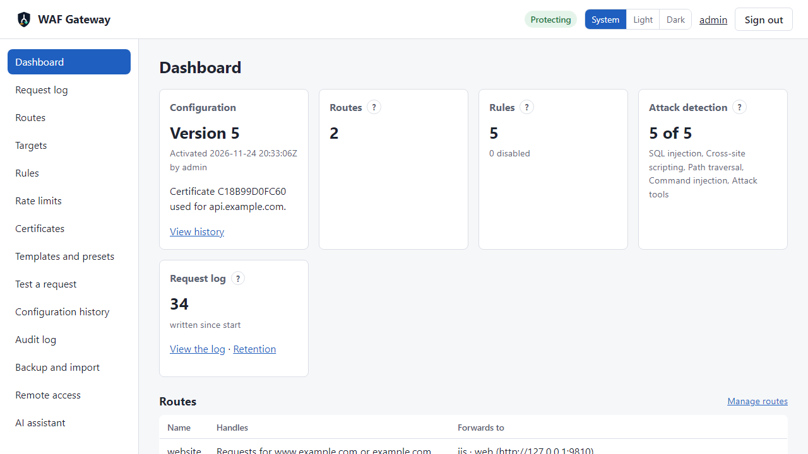

The [admin guide](docs/admin-guide.md) walks through the admin UI task by task. Its pages: a **dashboard** (firewall state, active configuration version, routes, rules, rate limits and attack detection in plain language), the **Request log** (see [Logging](#logging)), **Routes** (list, add, edit, enable/disable and delete routes), **Targets** (name a machine and its ports once, so routes forward to "nas · web" instead of an address), **Rules** (rules with any number of conditions, priority, action, per-rule and global detection-only mode, and IP block/allow lists where you paste addresses and CIDR ranges one per line), **Rate limits** (limit, window, what is counted, routes and conditions), **Certificates** (upload your own PFX or PEM certificates, choose their host names, see expiry warnings), **Templates and presets** (templates open the route, rule or rate-limit editor pre-filled for common cases such as a load-balanced site, an API key header or login attempts; one-click presets such as "Block common attacks", "Lock a path to your IP addresses" and "Protect a login page" first show a preview of exactly what will change, and applying one twice changes nothing), **Test a request** (describe a request and see whether the firewall would allow or block it, and why, without sending anything) the **configuration history** (open any version to see what it changed, compare it with the running configuration and restore it), the **Audit log**, **Backup and import** (export the configuration as JSON, import a file with a preview of the changes, download a full backup of every version and restore it), **Remote access**, the **AI assistant**, and **Your account** (password, two-factor sign-in, sessions, login history). Every change made in the UI is checked, stored as a new configuration version and applied immediately, without a restart; if someone else changed the configuration in the meantime, the change is refused instead of overwriting theirs. The forms work without JavaScript: buttons such as "Add another condition" re-show the form without saving. The UI is rendered on the server (Blazor, no WebSocket needed), works without JavaScript, has inline help (`?`) next to settings, and is sent with a strict Content-Security-Policy.

**Light and dark theme.** The switch at the top right (**System**, **Light**, **Dark**) sets the UI's colors. **System** (the default) follows the device's light or dark setting. A choice of Light or Dark is stored with your account (in `identity.db`), so it applies again at your next sign-in and on every device you sign in from; a change also reaches your other open sessions at their next page. The sign-in page itself follows the device's setting.

- **Localhost:** always available on `http://127.0.0.1:8900`. It cannot be disabled and needs no hostname or certificate. It answers only when addressed as `127.0.0.1`, `localhost` or `[::1]` (any port, so an SSH tunnel such as `ssh -L 8900:127.0.0.1:8900 pi@raspberrypi` works); any other host name gets 400, so a web page cannot reach it by pointing its own name at 127.0.0.1 (DNS rebinding).
- **Remote:** off by default. The admin turns it on under **Remote access** by registering an admin URL such as `https://admin.example.com`, or `https://admin.example.com:8443` for a port of its own (see [Remote access](#remote-access)).
- **Registration requirements:** 2FA enabled for your account, a valid certificate for that hostname, and a hostname not used by any route.
- **While remote access is on:** HTTPS only, mandatory 2FA, brute-force protection and lockout, an optional IP/CIDR allowlist, idle timeouts, login history, and a generic 404 before login.
- **First run:** the admin account can only be created from the local machine, or with a one-time token printed to the service log.

**Signing in.** Every page of the admin UI needs a signed-in admin account; only the sign-in pages, the first-run page, static files (stylesheet, logo, icon) and /healthz are open. On a fresh install, opening the admin UI leads to **Create the admin account**. On the gateway's own machine (a loopback connection, not passed on by a proxy) only a user name and password are asked. From anywhere else the page also asks for the **setup token**: at startup the gateway writes it to the service log (Windows Event Log or journalctl -u wafgateway), in a warning that starts with "No admin account exists yet". The token is random, works once and is replaced at every restart; as soon as the account exists, the first-run page is closed for good. Passwords need at least 12 characters (no other rules: a few unrelated words make a strong password). Change your password, turn on two-factor sign-in and see the login history under your user name at the top right.

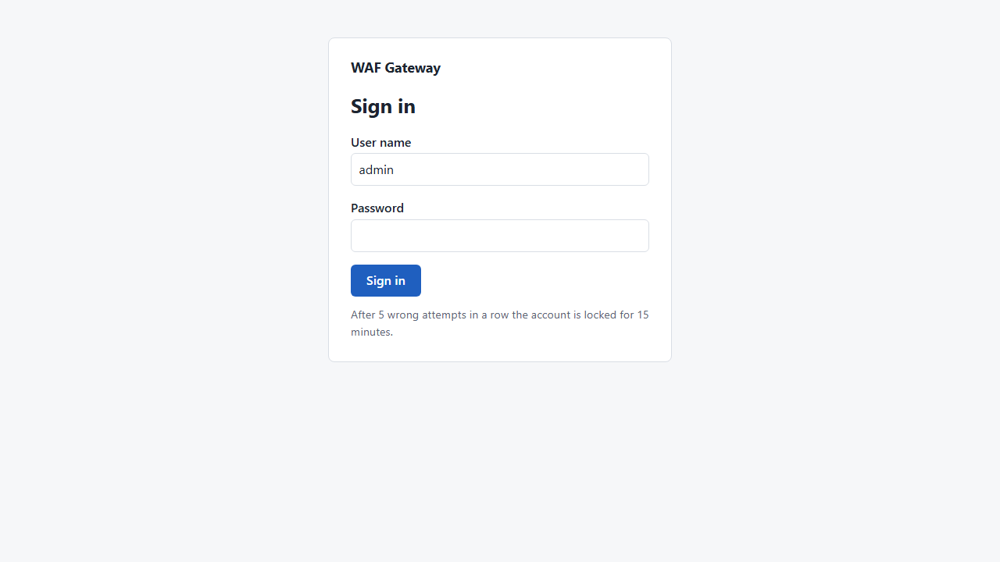

Accounts are stored in identity.db in the data folder, apart from the configuration, so they are not part of exports, backups or restores. The keys that protect the sign-in cookie are kept in the keys folder next to it (on Windows encrypted for the service account), so a restart does not sign you out. **Forgot the password?** Run `wafctl admin reset-password` on the gateway's machine (see [Recovery tool](#recovery-tool)): it sets a new password, unlocks the account and ends all sessions. Locked out after too many attempts? Wait 15 minutes, or reset the password.

**Two-factor sign-in (2FA).** Under **Your account → Two-factor sign-in**, scan the QR code with an authenticator app (Microsoft Authenticator, Google Authenticator, 1Password and the like; time-based 6-digit codes) or type the key shown under it, then enter the first code. You get 10 **recovery codes**, shown once: each one signs you in once if you lose your phone, and new ones can be made with your password. From then on, signing in asks for the code after the password. Turning 2FA off needs your password. On the local machine 2FA is optional, and the dashboard reminds you while it is off; remote access requires it.

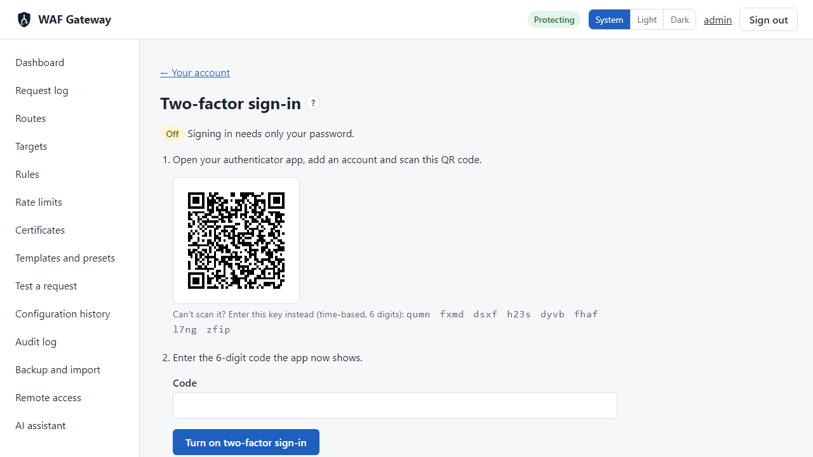

**Brute-force protection and sessions.**

- **Account lockout:** after 5 wrong passwords or 2FA codes in a row, the account is locked for 15 minutes, even for the right password.
- **Per address:** after 10 failed attempts within 15 minutes from one address (for any user name, so guessing names doesn't help), sign-in from that address is refused for 15 minutes.
- **Sessions:** a session ends after 15 minutes without activity (the live view of the request log doesn't count as activity) and 8 hours after signing in. The sign-in cookie is HTTP-only and same-site.
- **Ending sessions:** changing the password, changing 2FA or **Sign out other sessions** ends every other session at its next request.
- **Login history:** every sign-in, failed attempt, lockout and sign-out, with time, address and browser (the last 1,000, at most 90 days). Your account page shows the previous sign-in and the failed attempts since then. For an unknown user name, the name typed is not stored, as it may be a password typed into the wrong field.

**Audit log.** The **Audit log** page shows who changed what, and when: user name, address and time for every configuration change, sign-in, sign-out, lockout, password change, change to two-factor sign-in, ended sessions, backup restore, configuration or backup download (noting whether secrets were included) and log cleanup. Filter it by kind, by user or by configuration version. Every configuration version links to its audit entry, which also lists the routes, rules, rate limits and settings the version changed; the configuration history links back from each version. Entries are stored in `config.db`, are never changed or removed, and survive a backup restore. A restore adds an entry for each restored version that differs from the one it replaces, so every version still has an entry that describes it. Versions stored before the audit log existed get an entry with their author and comment when the database is upgraded. Single failed sign-in attempts are kept only in the login history, so guessing passwords cannot flood the audit log.

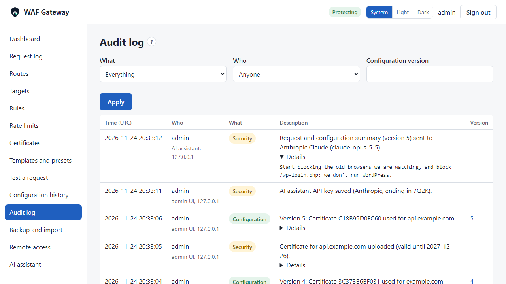

### Remote access

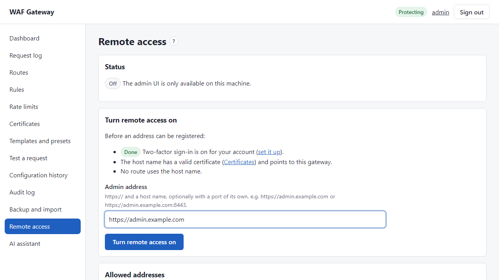

The **Remote access** page makes the admin UI reachable from other machines on an address of its own. It refuses to register the address until two-factor sign-in is on for your account, the host name has a working certificate (uploaded or Let's Encrypt; see [HTTPS and certificates](#https-and-certificates)) and no route uses the host name. Once registered:

- **HTTPS only.** Requests arrive on port 443 (or the address's own port), and both the TLS server name (SNI) and the `Host` header must be the registered host name. Over plain HTTP the host name answers 404, except Let's Encrypt challenges, so its certificate can still be renewed.
- **Hidden before sign-in.** Until you sign in, every address except the sign-in pages answers with the same empty 404 as an unknown address, without redirects or telling headers. Sign in at `https://admin.example.com/account/login`.
- **Two-factor sign-in is mandatory** remotely: an account without it is refused (after the password is checked), and 2FA cannot be turned off over remote access.
- **Allowlist** (optional): addresses and CIDR ranges, one per line; other addresses get the 404. The client address is resolved like public traffic, so it works behind trusted proxies.
- **A port of its own** (`https://admin.example.com:8443`): the gateway opens an extra HTTPS listener on that port at the next start; it serves only the admin UI. Open it in the firewall only if you want it reachable.
- The usual protections apply: lockout, per-address throttling, session timeouts, the login history and the audit log (registering, changing the allowlist and turning it off are recorded).

Turn it off on the page, or on the gateway's machine with `wafctl admin unregister-url` (also when you are locked out); a running gateway applies it within seconds. The settings are stored on this machine only (`identity.db`), never in configuration exports or backups.

The admin UI is exempt from user-defined WAF rules and from the fail-closed 503 state, so a bad rule can never lock you out.

## Configuration concepts

- **Routes:** match by host, path and/or method, then forward to a destination IP/hostname and port, or to a target.
- **Targets:** a named machine (`nas`) with labelled ports (`web` → 5000, `admin` → 5001). Routes forward to "nas · web"; when the machine's address or a port changes, it is changed in one place (see [Targets](#targets)).
- **Rules:** each has a name, conditions, an action (Allow, Block or LogOnly), a priority and an enabled flag. Rules can run in detection-only mode, per rule or globally.
- **Certificates:** Let's Encrypt (HTTP-01, with a staging switch) or your own PFX/PEM, per hostname (see [HTTPS and certificates](#https-and-certificates)).
- **Versions and rollback:** every change is stored as a configuration version. An invalid change never replaces the last working configuration, and any version can be restored.
- **Import/export:** the configuration (or any earlier version) can be exported to JSON and imported again, with a preview of the changes; export followed by import yields the identical configuration.
- **Backup and restore:** a full backup (`.zip`) holds every configuration version and which one is active. Restoring it replaces the history after checking everything; the previous `config.db` is kept as `config.before-restore-<time>.db` in the data folder.
- **Secrets in exports:** values of header conditions (such as API keys) are replaced by `[secret not exported]` unless "Include secrets" is ticked. Importing or restoring such a file keeps the values the gateway already has for the same rule and condition; where it has none, the import is refused instead of activating a placeholder.

### Routes in `appsettings.json`

Routes are normally managed in the admin UI. On a fresh install they can be seeded from `Gateway:Routes` (see *Where the configuration lives* below); this is the format:

```json
"Gateway": {
  "Routes": [
    {
      "Name": "api",
      "Match": { "Hosts": ["api.example.com"], "PathPrefix": "/api", "Methods": ["GET", "POST"] },
      "Destinations": [ { "Scheme": "http", "Address": "10.0.0.5", "Port": 8080 } ],
      "PreserveHost": true,
      "AllowInvalidBackendCertificate": false,
      "HealthCheck": { "Path": "/health", "IntervalSeconds": 10, "TimeoutSeconds": 5 },
      "Https": { "RedirectHttp": true, "Hsts": true }
    }
  ]
}
```

- **Match:** all given conditions must match; leave one out to match anything. `Hosts` accepts `*.example.com`. `PathPrefix` matches whole path segments (`/api` matches `/api` and `/api/users`, not `/apix`); the most specific route wins, and the path is forwarded unchanged. Requests that match no route get 404.
- **Destinations:** IP address or host name, port, `http` or `https`, or a target and port label (see [Targets](#targets)). Several destinations share the load; WebSockets are supported.
- **PreserveHost** (default `true`): the backend receives the client's original `Host` header, as IIS host bindings need.
- **AllowInvalidBackendCertificate** (default `false`): accept a self-signed certificate from an HTTPS backend you control.
- **Https** (both default `false`): `RedirectHttp` sends plain HTTP requests to HTTPS, `Hsts` adds the Strict-Transport-Security header; see [Redirect to HTTPS and HSTS](#redirect-to-https-and-hsts). With both off the route also works over plain HTTP.
- **HealthCheck:** with a `Path`, each destination is probed and taken out of rotation while it fails. Passive checks (failed requests) are always on.
- **ErrorMessage** (optional): one line of at most 300 characters for visitors when no backend answers, e.g. `"Planned maintenance until 14:00"`; see [When no backend answers](#when-no-backend-answers).
- **Failover:** a destination with `"Failover": 1` (2, 3, …) only gets traffic while no primary destination is healthy; see [Failover](#failover).
- **Forwarded headers:** `X-Forwarded-For`, `-Proto` and `-Host` are always set by the gateway; values sent by clients are overwritten and a client `Forwarded` header is removed. `X-Forwarded-For` carries the resolved client IP (see below).

#### Failover

A route can have **failover destinations**: a second network address of the same machine, or another machine that can take over. They get no traffic while a primary (a destination without `Failover`) is healthy.

```json
"Destinations": [
  { "Address": "10.0.0.5", "Port": 8080 },
  { "Address": "10.0.1.5", "Port": 8080, "Failover": 1 },
  { "Target": "nas", "TargetPort": "web", "Failover": 2 }
]
```

- **Which destination:** traffic goes to the healthy primaries, shared as usual. Only when none is healthy does it go to failover 1, then 2, and so on; failovers with the same number share the load. A failover can be an address, or a target and port label, including a target found by its MAC address. A route needs at least one primary.
- **Detection:** the route's health check (`HealthCheck.Path`) and failed requests. A primary that **refuses** the connection, or does not accept it within 5 seconds, is skipped at once: the same request goes to the next candidate, so visitors don't see the outage. A request whose sending has started is **never sent again** (that would not be safe for a POST): it gets the error. Set a health check path so a backend that stops answering is noticed within the check interval.
- **Back to the primary** once it has been healthy for 30 seconds (the hold time), so a primary that keeps going up and down does not bounce traffic back and forth. Without a health check, a primary that refused connections is tried again after 30 seconds.
- **Nothing healthy at all:** the route answers `503`.
- **Visible:** the Routes page shows "On failover 1 since 2026-11-24 10:42 UTC" and the dashboard warns. The request log names the destination that served each request, e.g. `http://10.0.1.5:8080/ · failover 1`. Switching to the failover and back is written to the service log (event IDs 900 and 901; 902 when nothing is healthy, 903 when a request was sent to the next destination).
- **In the route editor:** the backends go in **Backends**, the failovers in **Failover backends**, one per line, in the order they take over. **Add as failover** adds a target there.
- **Host settings** (`Gateway:Failover`, normally left out): `HoldTime` (default `00:00:30`), `ConnectTimeout` (`00:00:05`, for routes with failover destinations) and `RefusedPeriod` (`00:00:30`, how long a destination that refused a connection gets no traffic).

#### When no backend answers

When a route matches but no backend gives an answer, the client gets a short error with the right status, in the format it expects, instead of an empty response:

| Case | Status |
|---|---|
| No healthy backend (also after failover), or a target that is not found | `503`, with `Retry-After: 30` |
| The connection was refused or reset, or the backend's answer was invalid | `502` |
| The backend did not answer in time | `504` |

- **Format**, from the request:
  - a SOAP request gets a SOAP Fault: SOAP 1.2 (`env:Receiver`) for `application/soap+xml`, SOAP 1.1 (`soap:Server`) for `text/xml` with a `SOAPAction` header. As SOAP over HTTP requires, Faults come with HTTP **500**. The gateway's status (502, 503 or 504), its meaning, the request ID and the time are in the Fault's detail element (`gw:gatewayError`, namespace `urn:fa-soft:waf-gateway:error`);
  - otherwise the `Accept` header decides, then the request's `Content-Type`: JSON (`application/json`, `*/*+json`) gets `application/problem+json` and XML (`application/xml`, `text/xml`, `*/*+xml`) gets `application/problem+xml` (RFC 9457), with `type`, `title`, `status`, `detail`, `requestId` and `time`;
  - anything else, browsers included, gets a short HTML page: "This site is temporarily unavailable. Please try again in a few minutes.", with the logo, the status, the request ID and the time. It has no scripts and follows the visitor's light or dark setting.
- **The route's message** (`ErrorMessage`, "Message for visitors" in the route editor) is shown in every format: in the page, as `message` in JSON and XML, and in the Fault.
- **Nothing internal:** no backend address, port, route or target name, or exception text. Those are in the request log ("No backend available", "Backend error: …", "Backend timeout", and the backend tried); search it for the request ID shown on the error. Responses have `Cache-Control: no-store`, and `HEAD` requests get the headers only.
- **The dashboard** counts these errors per route since the gateway started.
- A failure after the response has started (halfway through a download) just ends the connection. The gateway's own answers (403 blocked, 429 rate limited, 503 fail-closed, 404 no route) are unchanged short texts.

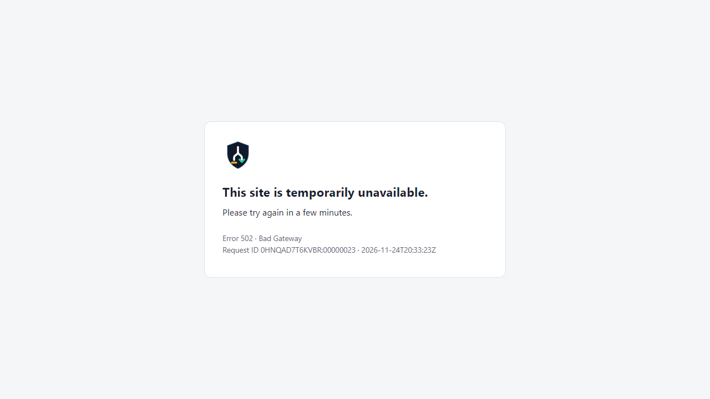

### Targets

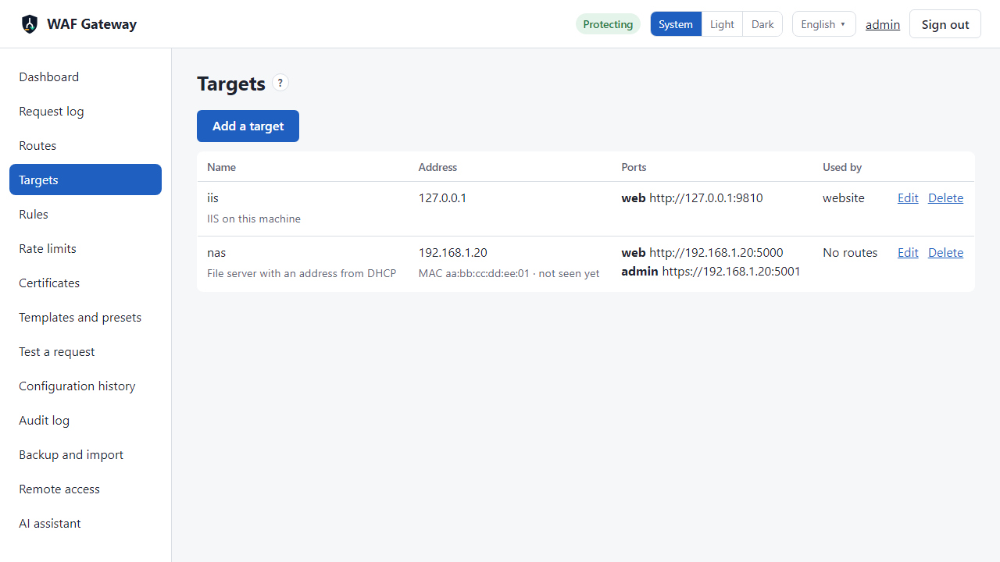

A **target** names a machine behind the gateway and its ports, under **Targets** in the admin UI or in `Gateway:Targets`:

```json
"Gateway": {
  "Targets": [
    {
      "Name": "nas",
      "Description": "Synology in the cupboard",
      "Address": "192.168.1.20",
      "Ports": [
        { "Name": "web", "Port": 5000, "Scheme": "http" },
        { "Name": "admin", "Port": 5001, "Scheme": "https" }
      ]
    }
  ],
  "Routes": [
    { "Name": "files", "Match": { "Hosts": ["files.example.com"] }, "Destinations": [ { "Target": "nas", "TargetPort": "web" } ] }
  ]
}
```

- **Name and port labels:** letters, digits, `-`, `_` and `.`; target names are unique, port labels unique per target. `Address` is an IP address or host name; each port has a number and `http` or `https`.
- **In routes:** a destination names `Target` and `TargetPort` instead of `Address`, `Port` and `Scheme` (not both). In the route editor, write it as `nas/web` in the backends, or pick it under **Add a target**. Lists show it as "nas · web (http://192.168.1.20:5000)".
- **One place to change:** a new address or port number for the target is one configuration version, and every route that uses it forwards to the new address at once, without a restart. Renaming a target or a port label in the editor renames it in its routes too.
- **Checks:** a route that names an unknown target or port is refused with a message that names it, and a target that routes still use cannot be deleted (the page lists them).
- The request log shows the label with the address it stood for at the time, e.g. `nas · web (http://192.168.1.20:5000/)`. Targets are part of versions, exports, backups, the configuration diff and the audit log; the AI assistant sees them and may propose changes to them.

#### Devices with a changing address (MAC address)

A device that gets its IP address from DHCP can move to another address. Give its target a **MAC address** instead of (or as well as) an address, and the gateway finds its current IP address in the operating system's neighbour (ARP) table:

```json
{ "Name": "nas", "MacAddress": "aa:bb:cc:dd:ee:01", "Address": "192.168.1.20", "ResolveIntervalSeconds": 60, "Ports": [ { "Name": "web", "Port": 5000 } ] }
```

- **How:** every `ResolveIntervalSeconds` (10 to 3600, default 60) the gateway reads the table: `ip neigh` (or `/proc/net/arp`) on Linux, `GetIpNetTable2` on Windows. An entry the system confirmed recently is used as it is. A stale one is confirmed first by contacting it (one UDP datagram to the discard port; no privileges, no ping). When the MAC address is not in the table at all, the gateway contacts every address of its own local networks (at most a /22, at most every 5 minutes) and reads again. In the target editor, **Look up MAC address** fills in the MAC address of the IP address you entered.
- **Routes follow the device** at once: they are rebuilt with the new address, without a new configuration version (the address is runtime state, not configuration). Each move is written to the service log and the audit log ("Target 'nas' (aa:bb:cc:dd:ee:01) is at 192.168.1.37 (was 192.168.1.20)"). The Targets page shows the MAC address, the address in use and when it was last seen.
- **Until it is found**, the configured `Address` is used (optional with a MAC address). **When it is gone** for 10 minutes, the target is unavailable: its destinations are left out, so its routes answer 503 instead of sending traffic to an address that may now belong to another device. The dashboard warns, the audit log records it, and traffic resumes as soon as it is found again.
- **Limits:** only devices on the gateway's own network segment (layer 2) can be found; not behind a router or VPN, or on a guest network with client isolation. Devices that use a random ("private") Wi-Fi address need that turned off for this network. A MAC address is not a proof of identity: anyone on the LAN can claim one, so use HTTPS backends with a valid certificate where it matters. Often simpler: a DHCP reservation in the router, or the device's host name.
- **Host settings** (`Gateway:TargetResolver`, normally left out): `Enabled` (false: no look-ups, targets keep their configured address), `GracePeriod` (default `00:10:00`), `SweepInterval` (`00:05:00`), `CheckInterval` (`00:00:05`) and `ProbeWait` (`00:00:01.500`).

### HTTPS and certificates

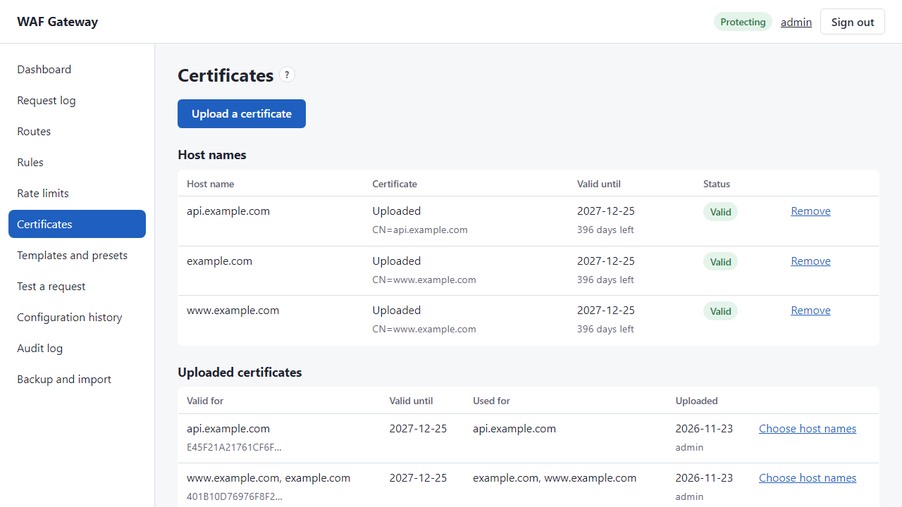

HTTPS on port 443 picks the certificate per connection by the host name the browser asks for (SNI). An exact host name wins over a wildcard (`*.example.com` covers `shop.example.com`, not `example.com` or `a.b.example.com`). A host name without a certificate gets no HTTPS connection at all: the gateway never serves a wrong or default certificate. Only TLS 1.2 and 1.3 are offered, with HTTP/2.

- **Upload your own** on the **Certificates** page: a PFX file (with its password) or PEM files (the certificate followed by its intermediate certificates, and the private key, optionally encrypted). The gateway checks that the key belongs to the certificate and that it has not expired, then stores it in `config.db` with the private key **encrypted** (ASP.NET Core Data Protection; the keys are in the data folder and protected with DPAPI on Windows). Then choose the host names it is used for; only names the certificate is valid for are offered. Intermediate certificates are sent with it.
- **Files on disk** (`Source: "File"` in the configuration): a PFX without password, or a PEM certificate and key; useful when another tool renews them. They are reloaded every 5 minutes.
- **Let's Encrypt** (`Source: "LetsEncrypt"`): see below.
- **Warnings:** a certificate that expires within 30 days, has expired, is missing or does not name its host is shown on the Certificates page and the dashboard, and written to the service log once a day.
- **Per host name** you choose: your own certificate (uploaded or a file) or Let's Encrypt. Switching is one configuration change and can be rolled back.
- **Backups:** which certificate a host name uses is part of the configuration (by SHA-256 thumbprint), so it is versioned and can be rolled back. The certificates themselves are not part of configuration versions or JSON exports; a full backup contains them, with their private keys, only with "Include secrets", and restoring it adds them to the certificate store. Uploads and deletions are recorded in the audit log.

#### Let's Encrypt

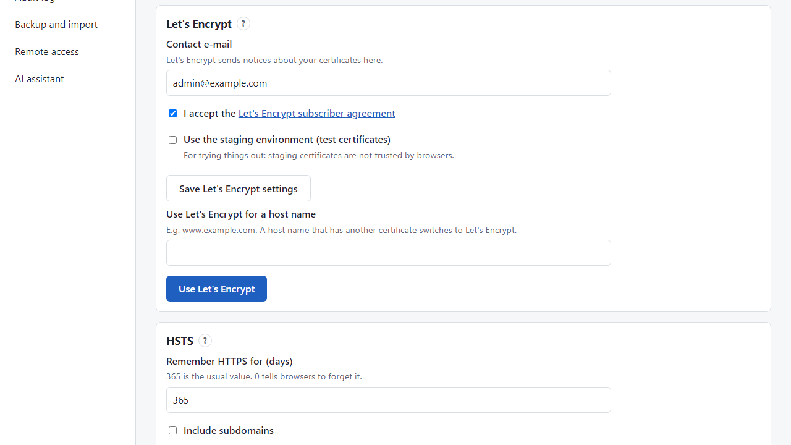

On the **Certificates** page, enter a contact e-mail, accept the Let's Encrypt subscriber agreement and choose **Use Let's Encrypt** for a host name. The gateway then:

1. creates a Let's Encrypt account (its key is stored encrypted, like certificate keys);
2. orders a certificate for the host name and proves control with **HTTP-01**: Let's Encrypt fetches `http://<host>/.well-known/acme-challenge/<token>`, which the gateway answers on port 80 before anything else (even while the WAF is fail-closed). The host name must point to the gateway and port 80 must be reachable from the internet;
3. stores the certificate (private key encrypted) and serves it over HTTPS at once;
4. **renews** it automatically when a third of its lifetime is left, at most 30 days before it expires (checked every hour and after every configuration change). A failed attempt is retried after 10 minutes, 1 hour, 6 hours, then daily (Let's Encrypt limits failed validations); **Request certificates now** retries at once after you fixed the cause.

The **staging** switch (`Settings.Acme.UseStaging`) uses the Let's Encrypt staging environment: untrusted test certificates with much higher rate limits, for trying things out. Production and staging use separate accounts and certificates; switching gets a certificate from the other environment. Wildcard host names (`*.example.com`) need DNS validation, which Let's Encrypt does not offer over HTTP: use your own certificate for those. Pending, failed and expiring certificates show on the Certificates page and the dashboard; issuance and renewal are recorded in the audit log.

Host settings in `appsettings.json` (not part of the configuration; normally left out):

```json
"Gateway": {
  "Acme": {
    "DirectoryUrl": null,                // another ACME server instead of Let's Encrypt, e.g. a test server
    "TrustedRootCertificatePath": null,  // PEM root to trust for that server (a test server's own CA)
    "CheckIntervalMinutes": 60
  }
}
```

#### Redirect to HTTPS and HSTS

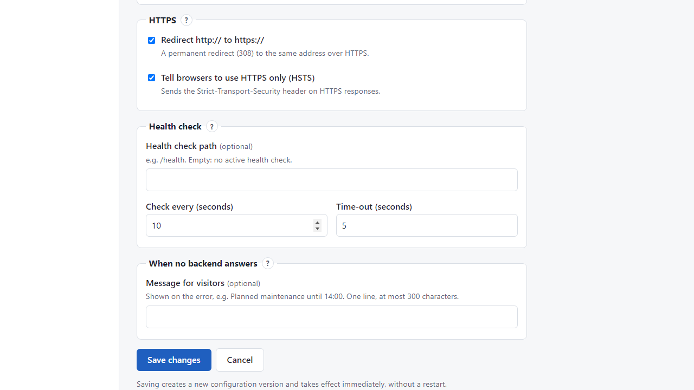

Per route, in the route editor (**HTTPS**):

- **Redirect http:// to https://** (`Https.RedirectHttp`): plain HTTP requests get a permanent redirect (`308`, which keeps the method and body) to the same address over HTTPS, on the gateway's HTTPS port. Every host name of the route needs a certificate first; the configuration is refused otherwise, because visitors would be sent to a failing connection. The redirect comes after the WAF (an attack over HTTP is blocked, not redirected) and never affects Let's Encrypt challenges, which are answered first. Redirects show as "Redirected to HTTPS" in the request log.
- **Tell browsers to use HTTPS only** (`Https.Hsts`): HTTPS responses carry `Strict-Transport-Security`, replacing one the backend may send. It is never sent over plain HTTP (browsers ignore it there, RFC 6797).
- **Plain HTTP routes** stay possible: a route with both options off answers on port 80 as before.

How long browsers remember HSTS is set once, on the **Certificates** page (`Settings.Hsts`): `MaxAgeSeconds` (default one year; up to two; 0 makes browsers forget it), `IncludeSubDomains` and `Preload` (for the browsers' built-in list at hstspreload.org; needs subdomains and at least a year, and is very hard to undo). Start with a short time and raise it once HTTPS works everywhere.

Behind a load balancer or proxy that terminates TLS and is on the trusted-proxy list, its `X-Forwarded-Proto: https` counts as HTTPS: no redirect loop, and HSTS is sent back; requests it received over plain HTTP are redirected to the standard HTTPS port.

### Client IP and trusted proxies

By default the client IP is the address of the TCP connection, and any `X-Forwarded-For` header is ignored. If the gateway sits behind another proxy or load balancer, list it under `Gateway:Settings:TrustedProxies` (IP addresses or CIDR ranges, IPv4 and IPv6):

```json
"Gateway": { "Settings": { "TrustedProxies": [ "10.0.0.1", "192.168.10.0/24" ] } }
```

For requests from a trusted proxy, `X-Forwarded-For` is read from right to left and the first address that is not a trusted proxy is the client IP. Entries further left were written by the client and are ignored, so they cannot be spoofed. An invalid entry (e.g. `unknown`) stops at the last valid address. The resolved client IP is what rules, rate limiting, logging and backends see.

On a first start, invalid routes in `appsettings.json` stop the gateway with a message that names the route and the problem. Later starts run the last-known-good configuration from `config.db` (see *Where the configuration lives*).

### Full configuration model and JSON schema

The complete configuration (`Settings`, `Routes`, `Rules`, `RateLimits`, `Certificates`) has one model, used by `appsettings.json` (under `Gateway`), export/import, the web UI and the AI assistant:

- [`schemas/gateway-config.schema.json`](schemas/gateway-config.schema.json): JSON schema, generated from the C# model. Add `"$schema": "./gateway-config.schema.json"` to a configuration file for completion and validation in your editor.
- [`schemas/gateway-config.example.json`](schemas/gateway-config.example.json): a complete, valid example with routes, rules (IP allowlist, required API key, detection-only rule) and certificates.

**Rules** have a name, priority (lowest first), action (`Allow`, `Block`, `LogOnly`), an enabled flag, an optional list of route names they apply to, and conditions. All conditions must match; a condition matches when any of its values matches (or none, with `Negate`). Fields: `ClientIp` (operator `InCidr`), `Method` (`Equals`), and `Host`, `Path`, `QueryString`, `UserAgent`, `Header` (`Equals`, `StartsWith`, `EndsWith`, `Contains`, `Regex`). Regular expressions use the .NET non-backtracking engine, so they cannot be abused for ReDoS (no backreferences or lookarounds).

**Detection-only:** set `DetectionOnly` on a rule, or `Settings.DetectionOnly` for all rules, to log Block decisions without enforcing them.

**Evaluation:** enabled rules run by priority (lowest first, then name). The first matching `Allow` or `Block` decides; `LogOnly` matches are recorded and evaluation continues; a `Block` in detection-only mode is recorded as "would block" and evaluation continues. If no rule decides, the request is allowed. A condition on a header that is absent never matches (so with `Negate` it always matches, e.g. "block when `X-Api-Key` is missing"). The rule set is compiled once and swapped atomically when the configuration changes.

Evaluation cost per request (`tests/Waf.Benchmarks`, run with `dotnet run -c Release --project tests/Waf.Benchmarks -- --filter *RuleEvaluation* --inProcess`), measured on a laptop: about 0.1 µs with 10 rules, 1.6 µs with 100 and 24 µs with 1000 when no rule matches (every rule evaluated), with no memory allocated for requests that match nothing.

**Rate limits** (`RateLimits`) allow at most `PermitLimit` requests per `WindowSeconds`, counted per `Key`: `ClientIp` (default), `ClientIpAndRoute`, or `Route` (all clients together, to protect a backend). Optional `Routes` and `Conditions` (same as rule conditions) select which requests count, e.g. only `POST /login`. Requests over the limit get `429 Too Many Requests` with `Retry-After`, or are only logged with `DetectionOnly`. The window slides, and rejected requests count too, so a client that keeps hammering stays limited until it slows down. IPv6 clients are counted per /64 network. Counters are kept in a memory-bounded table (`Settings.RateLimitMaxTrackedClients`, default 100,000): when full, expired counters and then the ones with the fewest requests are dropped, so a flood from many new addresses cannot reset the counter of a client that is already limited.

**Attack detection** (`Settings.AttackDetection`) looks for SQL injection, cross-site scripting, path traversal, command injection and known attack/scanner tools (sqlmap, nikto, …) in the path, every query parameter name and value, the `Referer`, `Cookie` and `User-Agent` headers, and optionally the body (`InspectBody`, up to `MaxBodyBytes`, default 64 KB): form fields and JSON string values one by one, other text as a whole; binary uploads are skipped. Every value is normalized before matching: repeated URL decoding (also double encoding and `%uXXXX`), HTML entities, full-width Unicode, SQL comments (`UNION/**/SELECT`), backslashes and case, so encoded payloads are caught. Signatures look for attack structure rather than single words to keep false positives low, and run on the non-backtracking regex engine (no ReDoS). Each category can be switched off, and `Exclusions` turn detection off for a path prefix (optionally per route and category) to allow known false positives. Measured cost: about 2.5 µs for a typical request, 0.27 ms for a 40 KB JSON body.

Configuration is read strictly: misspelled setting names, invalid values (e.g. `"Action": "Deny"`) and `null` where a value is required are errors with their location, never silently ignored. After changing the model, regenerate the schema by running the tests with `WAF_UPDATE_SCHEMA=1`.

## AI configuration assistant

Optional and disabled unless you provide an API key (default provider: Anthropic Claude, behind a pluggable interface).

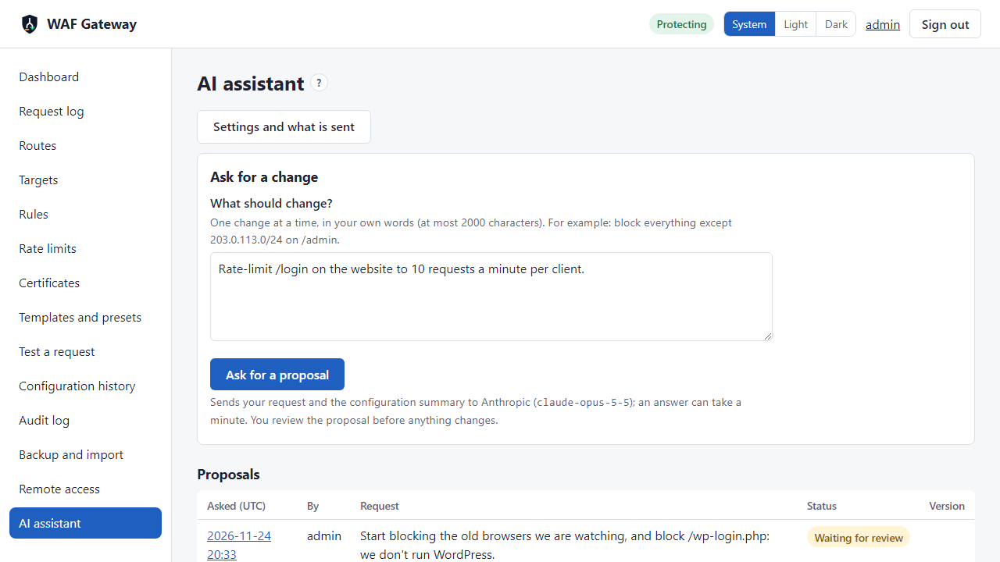

**Turning it on.** Create an API key in the [Anthropic Console](https://console.anthropic.com) and paste it under **AI assistant → Settings and what is sent** (`/ai/settings`); usage is billed by Anthropic to that account. The key is encrypted at rest (ASP.NET Core Data Protection, as for certificate keys) in `config.db`, is never shown again (only its last four characters), and is never part of configuration versions, exports or backups, not even a backup with secrets: it belongs to this machine and survives a backup restore. **Check the key** asks Anthropic whether the key works without running the model (free). **Remove the key** turns every AI feature off again. Saving and removing the key are recorded in the audit log. Without a key, nothing AI-related runs and the gateway sends nothing anywhere.

The assistant uses Claude Opus 5.5 (`claude-opus-5-5`) with high effort, through the official Anthropic SDK for .NET. If the model declines a request, Anthropic can answer it with a fallback model (server-side fallback); a refusal that remains is reported as such.

1. **Ask.** On the **AI assistant** page, describe one change in your own words, for example: *"Only the office network 203.0.113.0/24 may open /admin."* Your request and the configuration summary are sent to Anthropic (recorded in the audit log), one request at a time.
2. **Strict checks.** The model answers in a fixed format (structured output): a short summary and only the sections it changes. Every proposal is stored, and checked before you see an Approve button:
   - it may only change targets, routes, rules, rate limits and the settings for detection mode, trusted proxies, attack detection, log retention and HSTS; certificates, Let's Encrypt and other settings are refused;
   - each section it contains replaces that section; the result is read as strictly as an imported file, against the same JSON schema (unknown properties, wrong value types, unknown enumeration values and `null`s are errors, with their location) and the full configuration validation;
   - secret values the model saw as a placeholder are filled in from the running configuration, and only when they stay in the same rule or rate limit, at the same condition and header;
   - a proposal that changes nothing is refused too.

   A proposal that fails is shown as **Rejected by the checks**, with the reasons and the answer as it came back, and can never be applied. If the request is unclear, the model proposes no change and says why.
3. **Review.** The proposal page lists the differences in plain language (added, changed and removed routes, rules, rate limits and settings, each with its configuration on request), with the model's summary. Nothing is applied until you click **Apply these changes**; a proposal is applied at most once, and only while the configuration it was made for is still running (otherwise ask again).
4. **Approve.** Applying creates a new configuration version, with the comment "AI proposal N: …", the source "AI assistant" and your user name in the configuration history and the audit log. It takes effect immediately, without a restart.
5. **Undo.** **Undo** on the proposal page rolls back to the version the proposal was made for (stored as a new version), as long as nothing else changed since; otherwise restore that version on the history page.

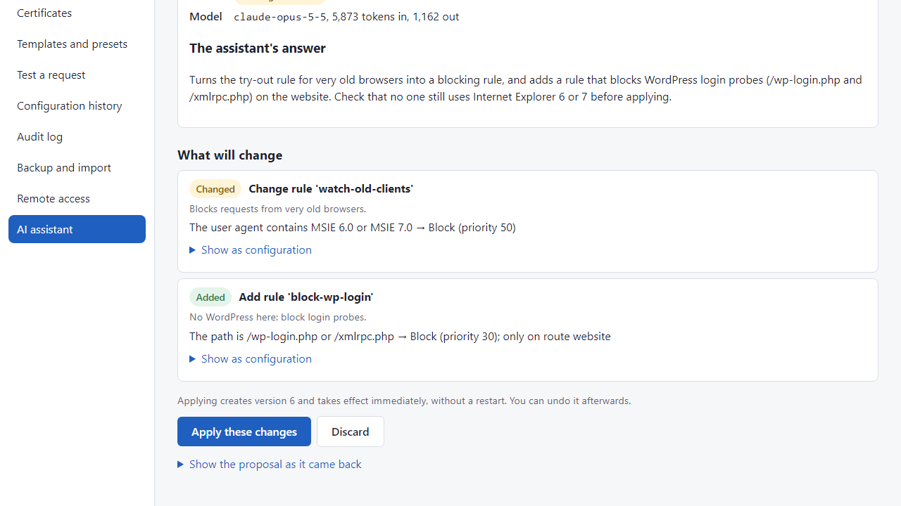

Proposals (request, answer, status, versions and token use) are kept in `config.db` on this machine, like the key: they are not part of exports or backups.

**Another API address.** To send the requests through an API gateway of your own instead of directly to Anthropic, set `Gateway:Ai:AnthropicBaseUrl` (for example `https://llm-gateway.example.com/anthropic`) in `appsettings.json`. The address is taken only from this setting, never from the Anthropic SDK's environment variables.

Only your prompt and a sanitized summary of the current configuration are sent. Request bodies, cookies, secrets and log content are never sent. The summary is built from an allowlist: routes, rules, rate limits, and the settings for detection mode, trusted proxies, attack detection, log retention and HSTS, with secret values (such as API keys in header conditions) replaced by a placeholder; certificates appear only as host name and source, and the Let's Encrypt e-mail, certificate files, the request log, accounts and remote access settings are left out. The page shows exactly what would be sent. Tests check the HTTP request the SDK builds: only these fields, and none of the secrets.

## Logging

Every public request is recorded in `events.db` (in the data folder) with timestamp, client IP, host, method, path, route, matched rule, action (forwarded, blocked, rate limited, fail-closed, no route), destination, status code and latency. Query strings, headers, cookie values and bodies are not stored, so tokens in URLs, authorization headers and form posts stay out of the log. For a detected attack only the matching fragment (at most 100 characters) is kept as evidence; for an attack found in a cookie only the cookie's name is recorded.

Logging never slows requests down: each entry goes into a bounded in-memory queue, and a background writer stores the queue in batches. When the disk cannot keep up (or `events.db` is locked or damaged), new entries are **dropped and counted** instead of making requests wait; the dashboard shows how many, and a warning is logged at most once a minute. Logging is best effort by design: the firewall's protection never depends on it. The queue is drained on shutdown. Host settings (in `appsettings.json`, not part of the configuration versions):

```json
"Gateway": {
  "EventLog": {
    "Enabled": true,               // false: no request log at all
    "QueueCapacity": 10000,        // entries that may wait to be written (100 to 1,000,000)
    "BatchSize": 500,              // entries per transaction
    "FlushIntervalSeconds": 0,     // 0 to 300: collect entries this long before writing (fewer, larger writes)
    "LogForwardedRequests": true   // false: only blocked, rate-limited, fail-closed, unrouted and flagged requests
  }
}
```

Blocked and flagged requests (WAF events) are also written to the application log (the service log: journald, or the Windows Event Log for the service), but at most 60 a minute; the rest are counted and summarized in one line ("N more WAF events since …"). So an attack flood can neither flood that log nor slow the gateway down with it. The request log keeps every request.

`FlushIntervalSeconds` turns many small writes into one per interval, which matters on an SD card (see [Raspberry Pi tuning](#raspberry-pi-tuning)). A full batch is still written at once, so a burst never waits for the interval, and what is collecting is written on shutdown. With `LogForwardedRequests` off, a request that was simply forwarded is not recorded; one that matched a rule in detection mode (or any other WAF event) still is.

The **request log** page shows it, newest first: filter by time range, what happened (blocked, would be blocked, forwarded, no route, server errors), client IP, host, route, rule or status, search free text, and page through older entries. Filters are part of the address, so a view can be bookmarked. "Live" adds new requests as they arrive (polling every 2 seconds; also with `?live=1` in the address). Paging works by entry id instead of offset and reads stop as soon as a page is full, so the viewer stays fast at any size: about 1 ms per page with a million entries, and about half a second for the worst case (a search without matches through all of them). From any entry you can turn what you see into configuration: **block its source** (added to your IP block list, or a new one), **allow a false positive** (an exclusion for the attack check that fired, limited to that path and route, or an Allow rule that runs just before the rule that blocked it), **create a route** for a host that had none, or **create a rule** for its path. Each action opens the normal editor pre-filled; nothing changes until you check it and save. Detection exclusions are listed on the Rules page, where they can be removed again. **Retention** keeps the log bounded by age and by size, set on the **Log retention** page (part of the configuration, so versioned and exported with it; defaults: 30 days, 1024 MB). A background job checks every minute: entries older than the age limit are removed, and when the log reaches 90% of its size limit the oldest entries are removed until it is at 80%. Space of removed entries is reused, so the file stops growing; when it is larger than the limit (for example after lowering it) the space is given back to the disk. Deletes run in small chunks, so request logging never waits long. The size limit holds as long as less than about a fifth of it is written per minute (for 1 GB: roughly a million requests a minute); an entry takes about 200–300 bytes.

```json
"Settings": {
  "LogRetention": { "MaxAgeDays": 30, "MaxDatabaseSizeMb": 1024 }  // MaxAgeDays 0: no age limit
}
```

## Installation

### Windows

Windows 10/11 and Windows Server 2016 or later, x64. Download `WafGateway-win-x64.zip` from the [releases](https://github.com/FA-Soft/WAF/releases) (or build the package yourself), extract it, and run the installer in Windows PowerShell **as Administrator**:

```powershell
# In the extracted folder (or build the package yourself: .\deploy\windows\Build-Package.ps1 in the repository)
.\Install.ps1                      # install the service, data folder ACLs, firewall rules for 80/443, start it
.\Install.ps1 -OpenAdminPort       # also open the remote admin port in Windows Firewall
.\Install.ps1 -MoveIisBindings     # explicitly rebind IIS sites away from 80/443 (backs up applicationHost.config first)
.\Install.ps1 -WhatIf              # show what would change, change nothing
.\Install.ps1 -Uninstall           # remove the service, firewall rules and program files; keep the data folder
```

What `Install.ps1` does:

- **Program files** go to `%ProgramFiles%\WafGateway` (`-InstallPath`), which is added to the `PATH` for `wafctl`. The package is self-contained: no .NET runtime needs to be installed.
- **Service.** `WafGateway` starts automatically and runs as its own virtual account, `NT SERVICE\WafGateway`, not as LocalSystem. It is restarted after a failure (after 5 s, 10 s, then every minute).
- **Data folder** `%ProgramData%\WafGateway` (`-DataPath`) is accessible only to that account, SYSTEM and Administrators: no inherited permissions, so other users cannot read the configuration, accounts, keys or request log. Existing files get the same permissions.
- **Firewall.** Inbound TCP 80 and 443 (or the `HttpPort`/`HttpsPort` from `appsettings.json`) is allowed for `WafGateway.exe` only, in the rule group "WAF Gateway". The local admin port (8900) is never opened: it only listens on `127.0.0.1` and `::1`. `-OpenAdminPort` also opens the port of the registered remote admin URL (read with `wafctl status`; see [Remote access](#remote-access)), or `-RemoteAdminPort <port>` before the URL is registered. When Windows Firewall is not running (another firewall is in use), no rules are made and the installer tells you which ports to open.
- **Start.** The installer starts the service and waits until the admin UI answers; then open `http://localhost:8900` on that machine to create the admin account. `-NoStart` installs without starting.
- **Upgrades.** Run the new package's `Install.ps1` again: the service is stopped, the program files are replaced and the service starts again. The data folder is kept, and so is an `appsettings.json` you put there (it overrides the built-in settings).

**IIS and other web servers.** Before starting, the installer lists IIS sites bound to ports 80 and 443 and any other program listening on them (HTTP.sys, used by IIS, shows up as `System`). Then:

- **Without `-MoveIisBindings` IIS is never changed.** The service is installed, but not started while the ports are in use; the installer tells you what holds them.
- **With `-MoveIisBindings`** the installer first backs up the IIS configuration to `%ProgramData%\WafGateway\backups\iis-<time>`: a verified copy of `applicationHost.config` (IIS is not touched if the copy does not match) and the HTTP.sys certificate bindings, plus, where IIS can make one, an IIS configuration backup named `WafGateway-<time>`. The folder's `README.txt` says how to undo the move. It then moves the sites' bindings on 80 and 443 to `127.0.0.1:8080` (http) and `127.0.0.1:8443` (https), keeping host names, certificates and SNI (other ports with `-IisHttpPort` and `-IisHttpsPort`). It refuses when a target binding is taken already. Add the sites as routes afterwards (the installer prints them, e.g. `www.example.com -> http://127.0.0.1:8080`). The installer waits up to 30 seconds for IIS to release the ports before it starts the gateway. To undo the move: `%windir%\System32\inetsrv\appcmd.exe restore backup "WafGateway-<time>"`, or copy the saved `applicationHost.config` back.

**Uninstalling** (`-Uninstall`) removes the service, the firewall rules, the program folder and the `PATH` entry, and keeps the data folder; `-RemoveData` deletes it too. It never changes IIS.

The installer is tested on every CI run on Windows Server (the `windows-latest` runner, with IIS installed): IIS is reported and left alone, then moved with `-MoveIisBindings`; install, `-OpenAdminPort`, upgrade and uninstall are checked (`deploy/windows/Test-Install.ps1`, which changes the machine it runs on: use it on test machines only). The same test also runs in a Windows Server 2025 container with IIS (no Windows Firewall there, so those checks are skipped):

```powershell
docker run --rm --isolation=hyperv -v "$PWD\artifacts\windows\WafGateway-win-x64:C:\pkg:ro" -v "$PWD\deploy\windows:C:\scripts:ro" `
  --entrypoint powershell mcr.microsoft.com/windows/servercore/iis:windowsservercore-ltsc2025 `
  -Command "Start-Service W3SVC; C:\scripts\Test-Install.ps1 -Package C:\pkg -WithIis; exit `$LASTEXITCODE"
```

### Ubuntu / Raspberry Pi

Ubuntu Server 22.04 or later (any distribution with systemd works the same way) on a Raspberry Pi with a 64-bit OS (`linux-arm64`) or on x64 (`linux-x64`). Download `wafgateway-linux-arm64.tar.gz` from the [releases](https://github.com/FA-Soft/WAF/releases), or build the package on any machine with the .NET SDK (it cross-compiles; on Windows use Git Bash) and copy it over. Then run the installer as root:

```bash
curl -fLO https://github.com/FA-Soft/WAF/releases/latest/download/wafgateway-linux-arm64.tar.gz   # on the Pi
# or: deploy/linux/build-package.sh linux-arm64 && scp artifacts/linux/wafgateway-linux-arm64.tar.gz pi@raspberrypi:

tar -xzf wafgateway-linux-arm64.tar.gz && cd wafgateway-linux-arm64
sudo bash install.sh               # install the service under a dedicated non-root user, and start it
sudo bash install.sh --ufw         # also allow 80/tcp and 443/tcp in UFW
sudo bash install.sh --no-start    # install or upgrade without starting
sudo bash install.sh --memory-max 512M   # limit the service's memory (see Raspberry Pi tuning); none removes it
sudo bash install.sh --uninstall   # remove the service and program; keep data and settings (--purge deletes them)
```

What `install.sh` does:

- **A dedicated user.** The system user `wafgateway` (no login shell, no home folder of its own) runs the service; nothing runs as root.
- **Program files** go to `/opt/wafgateway`, owned by root and read-only for the service. The package is self-contained: no .NET runtime needs to be installed. The installer refuses a package for the wrong processor (an x64 package on a Pi).
- **Folders.** Data in `/var/lib/wafgateway` (mode `0750`, owned by `wafgateway`: `config.db`, `identity.db`, `events.db`, the data protection keys); optional settings in `/etc/wafgateway/appsettings.json` (owned by root, readable by the service, not writable by it).
- **The systemd unit** `wafgateway.service` (from `deploy/linux/wafgateway.service`) starts at boot, restarts after a failure, and tells systemd when the listeners are up (`Type=notify`). Logs go to the journal: `journalctl -u wafgateway`.
- **`wafctl`** is on the `PATH` (`/usr/local/bin/wafctl`). Run it with `sudo`: it switches to the `wafgateway` user, so files it writes stay the service's (`sudo wafctl status`).
- **Start.** The installer starts the service and waits until the admin UI answers. If another program (nginx, Apache) holds port 80 or 443, the service is installed but not started, and the installer shows which program it is. Add that web server as a route on another port, then `sudo systemctl start wafgateway`.
- **Upgrades.** Run the new package's `install.sh` again: the service stops, the program folder is replaced, and the service starts again. Data and settings are kept, and so are your own unit changes in a drop-in (`sudo systemctl edit wafgateway`).

**Hardening.** The unit gives the gateway exactly one capability, `CAP_NET_BIND_SERVICE` (to bind ports 80 and 443 without root), and takes away the rest:

| Setting | Effect |
|---|---|
| `User=wafgateway`, `NoNewPrivileges=true`, `CapabilityBoundingSet=CAP_NET_BIND_SERVICE` | No root, no way to gain privileges, no other capability |
| `ProtectSystem=strict`, `StateDirectory=wafgateway` | The whole file system is read-only except `/var/lib/wafgateway` |
| `ProtectHome`, `PrivateTmp`, `PrivateDevices` | No home folders, a private `/tmp`, no device access |
| `ProtectKernelTunables`, `ProtectKernelModules`, `ProtectKernelLogs`, `ProtectControlGroups`, `ProtectClock`, `ProtectHostname`, `ProtectProc=invisible` | No changes to the kernel or system; other processes are invisible |
| `RestrictNamespaces`, `RestrictRealtime`, `RestrictSUIDSGID`, `LockPersonality`, `SystemCallFilter=@system-service`, `RestrictAddressFamilies=AF_INET AF_INET6 AF_UNIX AF_NETLINK` | Only the system calls and socket types a network service needs |

`MemoryDenyWriteExecute` is not set: the .NET JIT compiler needs it off. Check the result with `systemd-analyze security wafgateway`. On Linux the data protection keys are not encrypted (there is no DPAPI); the folder permissions protect them.

**UFW.** The installer never changes the firewall unless you pass `--ufw` (then it allows `80/tcp` and `443/tcp`, labelled "WAF Gateway"; `--uninstall --ufw` removes them). With UFW active and no `--ufw`, it prints the commands:

```bash
sudo ufw allow 80/tcp
sudo ufw allow 443/tcp
sudo ufw allow 8443/tcp            # only for a remote admin URL with a port of its own (see Remote access)
```

Never open the local admin port 8900: it listens on `127.0.0.1` and `::1` only. To reach the admin UI of a Pi from your PC before remote access is set up, use an SSH tunnel: `ssh -L 8900:localhost:8900 pi@raspberrypi`, then open `http://localhost:8900`. If you enable UFW on a machine you reach over SSH, allow SSH first (`sudo ufw allow OpenSSH`).

**Tests.** Every CI run builds the packages and runs `deploy/linux/test-install.sh` on Ubuntu with systemd: install, the service user, capabilities, hardening (`systemd-analyze security`), folders and permissions, `wafctl`, upgrade with a memory limit, uninstall and purge. `linux-x64` runs natively; the Raspberry Pi build (`linux-arm64`) runs the same test under QEMU emulation, because no arm64 runner is available to this repository. On a real Pi, copy `deploy/linux/test-install.sh` next to the extracted package and run it there (on a test Pi only: it installs and removes everything, data included):

```bash
scp deploy/linux/test-install.sh pi@raspberrypi:
sudo bash test-install.sh wafgateway-linux-arm64
```

### Raspberry Pi tuning

A Raspberry Pi has little memory and usually an SD card, which wears out from many small writes. The `linux-arm64` build and the installer are set up for that; the rest is a few settings.

**Memory.** The `linux-arm64` build uses .NET's workstation garbage collector without a background collection thread (set in its publish profile; the x64 builds keep the server collector, which trades memory for throughput). To cap its memory, give the service a memory limit: .NET reads the limit and keeps its heap below 75% of it, collecting more often instead of growing.

```bash
sudo bash install.sh --memory-max 512M     # writes /etc/systemd/system/wafgateway.service.d/memory.conf (MemoryMax=512M)
sudo bash install.sh --memory-max none     # removes the limit
```

Choose the limit from what the gateway really uses on your site: `systemctl status wafgateway` shows the current and peak memory (`Memory: ... (peak: ...)`). Leave room above the peak, because a limit that is too tight makes the kernel stop the service (systemd then restarts it). Upgrades keep the limit. To go back to the server collector (many cores, heavy traffic), add `Environment=DOTNET_gcServer=1` in `sudo systemctl edit wafgateway`.

**Fewer writes: the request log.** Every request is one row in `events.db`. On a quiet site that means a small transaction per request; on a busy one, batches of up to 500. Two host settings in `/etc/wafgateway/appsettings.json` reduce the writes (see [Logging](#logging)):

```json
{
  "Gateway": {
    "EventLog": {
      "FlushIntervalSeconds": 10,       // collect entries and write them together, at most every 10 seconds
      "LogForwardedRequests": false     // record only blocked, rate-limited, unrouted and flagged requests
    }
  },
  "Logging": { "LogLevel": { "Default": "Warning" } }   // less in the journal
}
```

Restart the service after changing it (`sudo systemctl restart wafgateway`). With `FlushIntervalSeconds`, a power failure loses at most that many seconds of the request log; the configuration database is not affected. Lower the **Log retention** size (for example 200 MB) so the log stays small.

**The journal.** The gateway's own messages go to the systemd journal, which Ubuntu keeps on disk. To keep it in memory only (lost at reboot), set `Storage=volatile` and, for example, `RuntimeMaxUse=50M` in `/etc/systemd/journald.conf`, then `sudo systemctl restart systemd-journald`.

**An SSD for the data folder.** An SSD on USB 3 (or NVMe on a Pi 5) lasts far longer than an SD card and is faster. Best: boot the whole system from the SSD (Raspberry Pi Imager writes the image to it; Pi 4 and 5 boot from USB). Otherwise, mount an SSD partition on the data folder, so nothing else changes:

```bash
sudo systemctl stop wafgateway
sudo mkfs.ext4 -L wafdata /dev/sda1                         # the SSD partition: this erases it
sudo mkdir -p /mnt/wafdata && sudo mount /dev/sda1 /mnt/wafdata
sudo cp -a /var/lib/wafgateway/. /mnt/wafdata/ && sudo umount /mnt/wafdata
echo 'LABEL=wafdata /var/lib/wafgateway ext4 defaults,noatime 0 2' | sudo tee -a /etc/fstab
sudo mount /var/lib/wafgateway && sudo systemctl start wafgateway
```

Keep the mount point `/var/lib/wafgateway`: the service may only write there (`ProtectSystem=strict`), and systemd sets its owner and mode at every start.

**Data locations**

| | Windows | Linux |
|---|---|---|
| Data | `%ProgramData%\WafGateway` | `/var/lib/wafgateway` |
| Configuration | in the data folder | `/etc/wafgateway` |

**Where the configuration lives:** the data folder holds `config.db` (SQLite), which is the source of truth for the gateway configuration (routes, rules, rate limits, settings, certificates) and keeps every version. On a fresh install, the `Gateway` section of `appsettings.json` seeds the first version; after that, changes are made in the admin UI. Later edits to the `Gateway` section of appsettings are **not** applied automatically, so they can never silently overwrite changes made in the UI: the dashboard shows that appsettings was changed, and you can **import** it (with all the usual checks, as a new version) or **dismiss** it. Listener ports (`Gateway:Endpoints`) and storage locations (`Gateway:Storage`) are always read from appsettings, at startup.

A configuration only becomes active after it passed every check (validation, building the WAF engine, YARP's route validation); on any failure the running configuration stays as it was. The last successfully activated version is the **last-known-good**, and it is what runs after a restart. Any earlier version can be restored; a rollback is stored as a new version, so the history only grows.

**Changes without a restart:** every accepted change is applied immediately. Swaps are atomic per request: every request is judged by the rules of the same configuration whose routes routed it, and requests in flight finish on the configuration they started with. A change identical to the running configuration is ignored, so rate-limit counters are kept. On a fresh install the folder (mode `0750` on Linux) and the database are created and migrated automatically; if that fails, the gateway stops with a message naming the folder. An optional `appsettings.json` in the configuration folder overrides the built-in settings (environment variables and command-line arguments still take precedence), so your settings survive upgrades. Both folders can be changed with `Gateway:Storage:DataDirectory` and `Gateway:Storage:ConfigDirectory`; in Development the data folder is `src/Waf.Host/.data` (git-ignored).

On a Raspberry Pi, store the data folder on an SSD where possible to reduce SD-card wear (see [Raspberry Pi tuning](#raspberry-pi-tuning)).

## Recovery tool

`wafctl` repairs the gateway locally on Windows and Linux, even when the service is down or you are locked out of the admin UI:

```text
wafctl rules disable-all                     # disable all rules
wafctl mode detection-only                   # log instead of block (rules, rate limits and attack detection)
wafctl mode enforce                          # block again
wafctl config restore-last-good              # activate the configuration that was active before the current one
wafctl config restore-last-good --version 7  # activate version 7 again
wafctl config history                        # list the newest configuration versions
wafctl admin reset-password                  # new password; also unlocks the account and ends all sessions
wafctl admin reset-2fa                       # turn two-factor sign-in off
wafctl admin allow-ip <address-or-cidr>      # add an address range to the remote admin allowlist
wafctl admin unregister-url                  # turn remote admin access off
wafctl status                                # data folder, active configuration, admin accounts, remote access
```

- **Local privileges only.** `wafctl` needs no network and no sign-in: it works directly on the data folder (`config.db`, `identity.db`). Run it as Administrator on Windows. On Linux, run it with `sudo` (`sudo wafctl status`): the installed `wafctl` switches to the service account, so files it writes stay the service's. It finds the data folder the same way the service does (the same appsettings and environment variables); `--data-dir <path>` points it elsewhere.
- **Configuration changes are normal versions.** `rules disable-all`, `mode …` and `config restore-last-good` check the result like the admin UI does, store it as a new configuration version and make it the active one. A running gateway applies it within about two seconds; a stopped one uses it at the next start. Nothing is changed when there is nothing to do.
- **Accounts.** `admin reset-password` asks for the new password twice without showing it (or reads one line with `--password-stdin` for scripts); the same rules as in the admin UI apply. With several admin accounts, choose one with `--user <name>`.
- **Remote admin access** settings (registered URL and allowlist) are stored on this machine only, next to the admin account, and are never part of configuration exports or backups.
- **Audited.** Every change is recorded in the audit log, with the operating-system user and source `wafctl`.
- Exit codes: 0 done (or nothing to do), 1 failed, 2 wrong usage.

## Repository layout

```
src/Waf.Core      Domain models, interfaces, configuration schema
src/Waf.Engine    Rule evaluation, attack detectors, rate limiter
src/Waf.Proxy     YARP integration, middleware, certificates, ACME
src/Waf.Data      EF Core (config.db, events.db, identity.db), migrations
src/Waf.Ai        AI provider interface and proposal schema
src/Waf.Web       Blazor UI, identity, log viewer, sample library
src/Waf.Host      Startup, Kestrel, service hosting
src/Waf.Cli       wafctl
tests/            Unit, integration and benchmark projects; Waf.LoadTests (waf-loadtest, load tests of a package)
docs/             Admin guide, security review, performance results, screenshots; docs/brand: logo, mark, icons
schemas/          JSON schema of the configuration, with a complete example
SECURITY.md       How to report a vulnerability
LICENSE           Proprietary license (FA-Soft)
THIRD-PARTY-NOTICES.md  Licenses of the components the release packages include
deploy/windows    Install.ps1 (service, firewall, IIS), Build-Package.ps1, Test-Install.ps1, Smoke-Test.ps1
deploy/linux      install.sh, wafgateway.service (systemd), build-package.sh, test-install.sh, smoke-test.sh
Publish.props     Release build settings for the publish profiles
```

## Building from source

Requires the [.NET 11 SDK](https://dotnet.microsoft.com/download) (pinned in `global.json`).

```bash
dotnet build WafGateway.sln
dotnet test --solution WafGateway.sln
```

Run it locally with `dotnet run --project src/Waf.Host`. In the Development environment the public listeners use `127.0.0.1:5080` (HTTP) and `127.0.0.1:5443` (HTTPS) so they don't need ports 80/443; the admin UI is at `http://127.0.0.1:8900`. Listener settings are under `Gateway:Endpoints` in `appsettings.json` (`HttpPort`, `HttpsPort`, `AdminPort`, `PublicBindAddress`). The admin listener always binds to `127.0.0.1` and `::1` only.

Shared build settings live in `Directory.Build.props` (nullable, analyzers, warnings as errors) and NuGet versions in `Directory.Packages.props` (central package management). Tests use xUnit v3 on Microsoft.Testing.Platform.

**Let's Encrypt tests.** The regular tests run the whole ACME flow (account, HTTP-01 through the gateway's port 80 listener, issuance, renewal) against a small in-process ACME server. One more test runs it against [Pebble](https://github.com/letsencrypt/pebble), Let's Encrypt's own test CA, in Docker (Linux or Windows containers); it is skipped unless `WAF_PEBBLE=1` is set:

```bash
WAF_PEBBLE=1 dotnet test --project tests/Waf.IntegrationTests --filter-class "*PebbleTests"
```

Pebble validates HTTP-01 by connecting from the container to the gateway's HTTP port on this machine. On Windows the firewall blocks that by default; allow inbound TCP from the Docker NAT network, for example (elevated): `New-NetFirewallRule -DisplayName "WAF Gateway tests - inbound from Docker NAT" -Direction Inbound -Action Allow -Protocol TCP -InterfaceAlias "vEthernet (nat)" -RemoteAddress LocalSubnet`.

Database migrations use the repository-local `dotnet-ef` tool (`dotnet tool restore`, then e.g. `dotnet dotnet-ef migrations add <Name> --project src/Waf.Data --startup-project src/Waf.Data`). A unit test fails when the EF model changes without a migration.

**Publish profiles.** Release builds use the publish profiles in `src/Waf.Host/Properties/PublishProfiles` and `src/Waf.Cli/Properties/PublishProfiles` (`win-x64`, `linux-arm64`, `linux-x64`), with the shared settings in [`Publish.props`](Publish.props): self-contained, single file, English resources only, no debug symbols, and for `linux-arm64` the low-memory garbage collector. ReadyToRun (precompiled code) is off: it would start the gateway faster, but makes the `linux-arm64` file 2.5 times as large (136 MB to 350 MB). The package scripts use the profiles; to publish one program by hand:

```bash
dotnet publish src/Waf.Host -c Release -p:PublishProfile=linux-arm64   # artifacts/publish/linux-arm64
```

**Releases.** Pushing a version tag runs [`.github/workflows/release.yml`](.github/workflows/release.yml): it builds the three packages with that version, starts each one once on a machine without .NET (`deploy/windows/Smoke-Test.ps1` with the runner's .NET hidden; `deploy/linux/smoke-test.sh` in a plain Ubuntu 24.04 container, `linux-arm64` under QEMU), and attaches the packages and `SHA256SUMS.txt` to a GitHub release with generated notes. A tag with a hyphen becomes a pre-release. Running the workflow by hand builds and tests without releasing.

```bash
git tag v1.0.0 && git push origin v1.0.0
```

**Load tests.** `tests/Waf.LoadTests` (`waf-loadtest`) measures a published package: it starts a backend and the gateway and sends clean, POST and attack requests, directly and through the gateway. Results and how to run it, also against a Raspberry Pi: [docs/performance.md](docs/performance.md).

```bash
dotnet build tests/Waf.LoadTests -c Release
tests/Waf.LoadTests/bin/Release/net11.0/waf-loadtest suite --gateway "$PWD/artifacts/linux/wafgateway-linux-x64/WafGateway"
```

**Security checks.** Every build runs all security rules of the .NET analyzers (as errors) and a NuGet audit of direct and transitive packages (high and critical advisories fail the build). See [docs/security-review.md](docs/security-review.md).

GitHub Actions ([`.github/workflows/ci.yml`](.github/workflows/ci.yml)) builds and tests every push to `main` and every pull request on Windows and Ubuntu, then publishes self-contained single-file builds for `win-x64` and `linux-arm64` with the publish profiles as a smoke check. A *Security scan* job reports vulnerable and deprecated packages and checks the installer scripts with ShellCheck and PSScriptAnalyzer; a *Load test* job runs `waf-loadtest` against the `linux-x64` package and puts the report on the run's summary page. Dependabot ([`.github/dependabot.yml`](.github/dependabot.yml)) proposes package and action updates weekly. Each run's summary page shows a test report per OS (passed/failed/skipped per test assembly, failure details and code coverage), and failed tests appear as annotations. Test results (TRX, Cobertura coverage) and the builds are also uploaded as workflow artifacts.

## Development milestones

The first release completes all ten milestones:

| Milestone | Scope |
|---|---|
| M1 | Solution skeleton, CI on Windows and Linux, static proxy routing |
| M2 | Rule engine, middleware, fail-closed behavior |
| M3 | Persistence, hot reload, last-known-good configuration |
| M4 | Web UI for rules and routes, sample library, import/export/backup |
| M5 | Logging, log viewer, log-to-route flow, retention |
| M6 | Authentication, 2FA, audit log, local admin, `wafctl` |
| M7 | TLS (own certificates and Let's Encrypt), remote admin URL registration |
| M8 | AI configuration assistant |
| M9 | Service installers, publish profiles, Raspberry Pi tuning |
| M10 | Hardening, load tests on desktop and Pi, documentation |

## Security notes

- Fail-closed by design; there is no fail-open mode.
- Secrets, authorization headers and full request bodies are not logged by default.
- Private keys of uploaded certificates are stored encrypted at rest (ASP.NET Core Data Protection, keys protected with DPAPI on Windows) and are only included in a full backup when "Include secrets" is chosen; the AI API key is encrypted the same way, but never leaves the machine, not even in a backup with secrets. Values of header conditions (such as API keys) are left out of exports and backups unless "Include secrets" is chosen.
- Forwarded client-IP headers are trusted only from addresses on the trusted-proxy list.
- The admin UI listens on loopback only and answers only to `localhost`, `127.0.0.1` and `[::1]` (against DNS rebinding); remote admin access is opt-in, HTTPS only (with HSTS) and needs two-factor sign-in.
- The [security review](docs/security-review.md) lists what was checked (headers, secrets, fail-closed behavior, admin exposure), the findings and what is accepted. Every build runs the .NET security analyzers and a NuGet vulnerability audit; CI also scans the installer scripts and reports vulnerable packages, and Dependabot proposes updates.
- Performance: see [docs/performance.md](docs/performance.md) for load-test results and how to measure your own machine or Raspberry Pi.
- Report vulnerabilities privately; see [SECURITY.md](SECURITY.md).

## Contributing

WAF Gateway is proprietary software of FA-Soft. Contributions are accepted only by arrangement with FA-Soft; report problems and ideas as issues, and vulnerabilities privately as described in [SECURITY.md](SECURITY.md).

Conventions for the code:

**Namespaces start with `FASoft.`** Every class, record, struct, interface, enum and Razor component lives in a namespace that starts with `FASoft.`, e.g. `FASoft.Waf.Data` for `src/Waf.Data`. Project and assembly names stay `Waf.*`. `Directory.Build.props` sets the root namespace to `FASoft.<project name>`, so new files and Razor components get the right namespace by default. `NamespaceConventionTests` fails the build for any namespace, or file without a namespace, that does not follow the rule.

## License

Proprietary: Copyright © 2026 FA-Soft, all rights reserved. Using, copying or distributing WAF Gateway needs the written permission of FA-Soft; see [LICENSE](LICENSE).

The release packages include third-party components (the .NET runtime, ASP.NET Core, Entity Framework Core, YARP, SQLite, the Anthropic SDK and others) under their own licenses (MIT, Apache-2.0, public domain), listed with their license texts in [THIRD-PARTY-NOTICES.md](THIRD-PARTY-NOTICES.md), which every package contains. `LicenseTests` fails the build when a shipped package is missing from that list.
