# WAF Gateway admin guide

How to run WAF Gateway day to day: from the first sign-in to putting a site behind it, protecting it, watching what
happens, undoing mistakes and recovering when something goes wrong. Installation and the reference details (every
setting, the file locations, the build) are in the [README](../README.md); screenshots of every page are in
[images.md](images.md).

**Contents**

1. [Before you start](#1-before-you-start)
2. [First sign-in](#2-first-sign-in)
3. [The dashboard](#3-the-dashboard)
4. [Put a site behind the gateway](#4-put-a-site-behind-the-gateway)
5. [Protect it](#5-protect-it)
6. [Watch the traffic](#6-watch-the-traffic)
7. [Changes, history and backups](#7-changes-history-and-backups)
8. [Remote access](#8-remote-access)
9. [The AI assistant](#9-the-ai-assistant)
10. [When something goes wrong](#10-when-something-goes-wrong)
11. [Maintenance](#11-maintenance)

## 1. Before you start

- **The machine:** Windows 10/11 or Windows Server (x64), or Ubuntu (or another systemd Linux) on a Raspberry Pi
  (64-bit) or x64. No .NET needs to be installed.
- **Ports 80 and 443** must be free for the gateway: it receives all web traffic and passes it on. A web server that
  uses them now (IIS, nginx, Apache) moves to another port and becomes a backend. The Windows installer can move IIS
  for you (`-MoveIisBindings`).
- **DNS:** the host names of your sites must point to the gateway's public address, and port 80 must be reachable from
  the internet if you want Let's Encrypt certificates.
- **Install** with the package for your platform: [Windows](../README.md#windows) or
  [Ubuntu / Raspberry Pi](../README.md#ubuntu--raspberry-pi). The installer starts the service and waits until the
  admin UI answers.

The admin UI is at **`http://127.0.0.1:8900`** on the gateway's own machine. It is never reachable from the network
unless you set up [remote access](#8-remote-access). From your PC, reach a Raspberry Pi's admin UI with an SSH
tunnel:

```bash
ssh -L 8900:127.0.0.1:8900 pi@raspberrypi     # then open http://localhost:8900 on your PC
```

## 2. First sign-in

1. **Create the admin account.** Open the admin UI. On a fresh install it shows **Create the admin account**: choose a
   user name and a password of at least 12 characters (a few unrelated words are strong and easy to type).
   - On the gateway's own machine or through an SSH tunnel, that is all.
   - From anywhere else the page also asks for the **setup token**. Find it in the service log: the Windows Event Log,
     or `journalctl -u wafgateway` on Linux, in a warning that starts with "No admin account exists yet". The token
     works once and changes at every restart.

   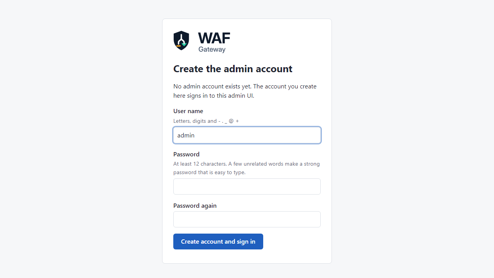

2. **Turn on two-factor sign-in.** Click your user name at the top right, then **Two-factor sign-in**.
   1. Scan the QR code with an authenticator app (Microsoft Authenticator, Google Authenticator, 1Password and the
      like), or type the key shown under it.
   2. Enter the first code.
   3. Store the 10 **recovery codes** somewhere safe. They are shown only once, and each signs you in once if you lose
      your phone.

   It is optional on the local machine (the dashboard reminds you while it is off), but required for remote access.

   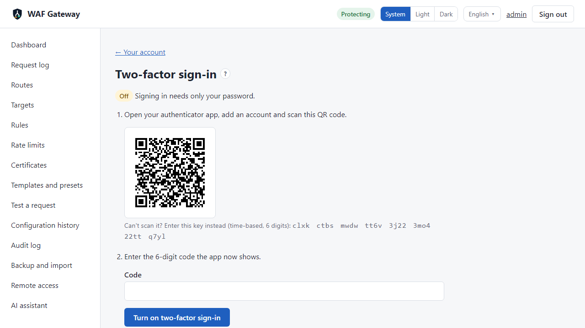

3. **Choose the theme** if you like: **System**, **Light** or **Dark** at the top right. Light and Dark are stored with
   your account and apply on every device you sign in from.
4. **Choose the language** if you like. The admin UI follows your browser's language (English, Dutch, French or
   German; English for any other language). The language menu at the top right sets one for your account, on every
   device; **Browser** goes back to following the browser.

**Sign-in rules worth knowing:**

- **Lockout:** after 5 wrong passwords or codes in a row the account is locked for 15 minutes. After 10 failed
  attempts from one address, that address is refused for 15 minutes.
- **Sessions:** a session ends after 15 minutes without activity, and 8 hours after signing in.
- **Signing out elsewhere:** changing your password or two-factor sign-in, or **Sign out other sessions** on Your
  account, signs out every other session.
- **Login history:** Your account → **Login history** shows every sign-in, failed attempt and lockout, with address
  and browser.

## 3. The dashboard

The badge at the top right always shows what the firewall is doing:

| Badge | Meaning |
|---|---|
| **Protecting** | Rules, rate limits and attack detection are enforced. |
| **Detection only** | Everything is checked and logged, but nothing is blocked: requests that would be blocked are marked "would be blocked" in the request log. |
| **Unavailable: public traffic is refused** | The firewall cannot run (hover over the badge for the reason). Every public request gets `503`: nothing passes unchecked. The admin UI keeps working so you can fix it; see [When something goes wrong](#10-when-something-goes-wrong). |

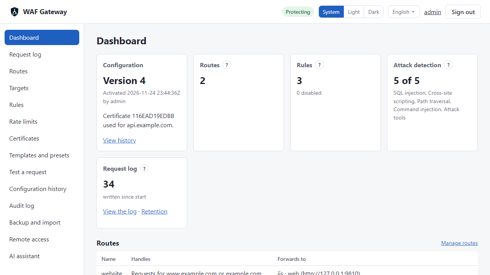

The dashboard shows the active configuration version and who made it, your routes, rules, rate limits and attack
detection in plain language, the request log's counters, and warnings: certificates that expire within 30 days,
dropped log entries, two-factor sign-in still off, a route running on its failover backend, a target that is not
found, or an `appsettings.json` that was edited after the first start.

## 4. Put a site behind the gateway

### Name your machines (targets)

Optional, but handy as soon as a machine serves more than one site, or its address might change. On **Targets →
Add a target**:

1. Give the machine a name, for example `nas`, and its address, for example `192.168.1.20`.
2. Give each port a label: `web` for port 5000, `admin` for port 5001. Tick **HTTPS** when the machine answers with
   TLS on that port.

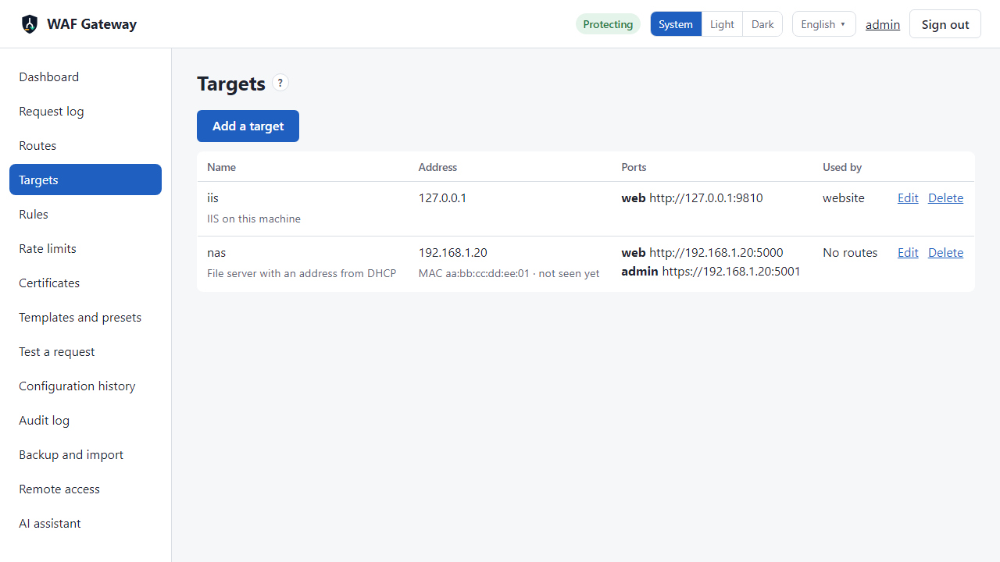

Routes can then forward to "nas · web" instead of an address: pick it under **Add a target** in the route editor, or
type `nas/web` in the backends. When the machine gets another address, change it once on the Targets page, and every
route that uses it follows at once. A target that routes still use cannot be deleted; the page tells you which routes.

**A device whose address changes (DHCP).** Enter its MAC address under **Changing address (DHCP)**. Don't know it?
Type the device's current IP address, click **Look up MAC address**, and the gateway fills it in. From then on the
gateway looks up the device's current address every minute, and its routes follow it. The Targets page shows the
address in use and when it was last seen. If the device is gone for 10 minutes, its routes stop sending traffic
(visitors get 503) until it is back, and the dashboard tells you. This works only for devices on the gateway's own
network. Phones and laptops with a "private Wi-Fi address" need that switched off for this network. A fixed address
in your router (DHCP reservation) is often simpler.

### Add a route

A route says which requests go to which backend. **Routes → Add a route**:

- **Match:** host names (`www.example.com`, or `*.example.com` for all subdomains), optionally a path prefix (`/api`
  matches `/api` and `/api/users`) and methods. Leave a field empty to match anything. The most specific route wins.
- **Destinations:** the backend's address and port, for example `127.0.0.1:8080` for IIS on the same machine or
  `10.0.0.5:80` for another server. Several destinations share the load. Tick **Accept a self-signed certificate from
  https:// backends** only for a backend of your own on a trusted network.
- **Health check** (optional): a path such as `/health`, probed regularly; a destination that fails is skipped until
  it recovers.
- **Failover backends** (optional): backends that only get traffic while none of the backends above works, for
  example a second network address of the same machine, or a spare machine. One per line: the first line takes over
  first. When the primary is back and has stayed healthy for 30 seconds, traffic returns to it. Set a health check
  path as well, so a backend that stops answering is noticed quickly.
- **Message for visitors** (optional): a line such as "Planned maintenance until 14:00", shown when no backend
  answers. Visitors then get a short error page ("This site is temporarily unavailable"); programs get the same error
  as JSON, XML or a SOAP fault. It never shows your internal addresses; the request log has the details. The fields
  **Nederlands**, **Français** and **Deutsch** hold the message for visitors whose browser prefers that language;
  others get the message above. The error page itself is always in the visitor's language.
- **Send the original host name to the backend** (on by default): the backend sees the visitor's `Host` header, as IIS
  host bindings expect.

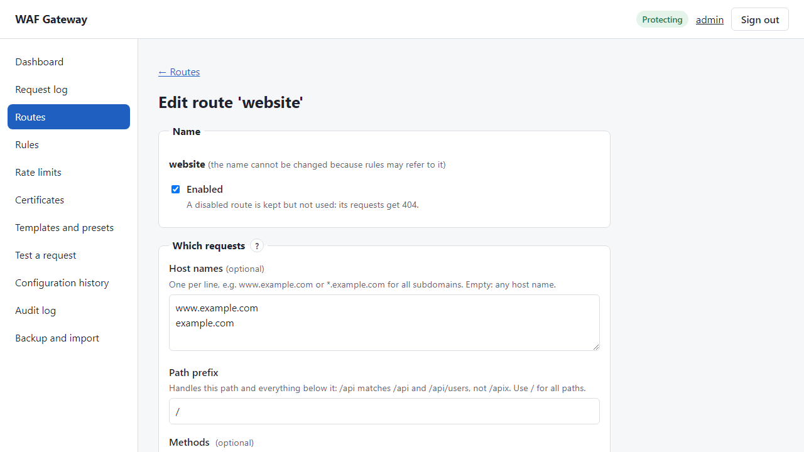

Save, and the route works immediately. Requests that match no route get `404`.

### HTTPS certificates

Each host name needs a certificate for HTTPS. On **Certificates**:

- **Let's Encrypt:** enter a contact e-mail, accept the subscriber agreement, and choose **Use Let's Encrypt** for the
  host name. The gateway requests the certificate right away, shows its progress on the page, and renews it
  automatically. The host name must
  point to the gateway, and port 80 must be reachable from the internet. Wildcard names (`*.example.com`) need your own
  certificate.
- **Your own certificate:** **Upload a certificate** (a PFX with its password, or PEM certificate and key), then
  choose the host names it is for.

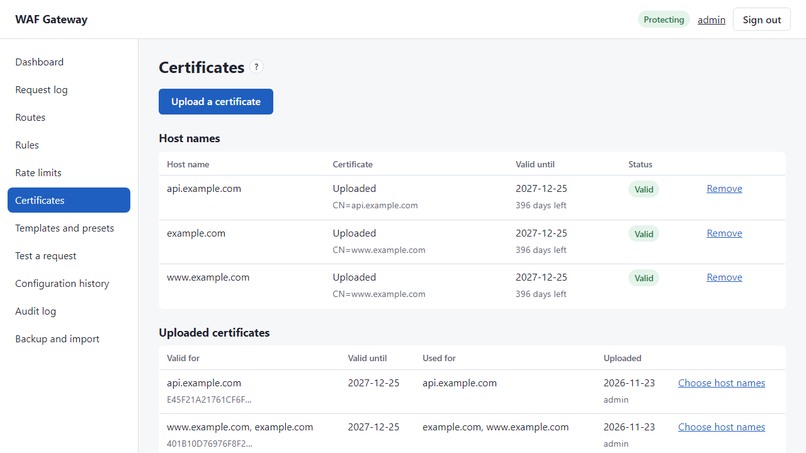

A host name without a certificate gets no HTTPS connection at all (never a wrong certificate). Problems and
certificates that expire within 30 days show on the Certificates page and the dashboard. If Let's Encrypt failed,
fix the cause (usually DNS or port 80), then click **Request certificates now**.

### Redirect to HTTPS

Once the certificate works, edit the route and switch on, under **HTTPS**:

- **Redirect http:// to https://**: visitors on plain HTTP are sent to HTTPS.
- **Tell browsers to use HTTPS only (HSTS)**: browsers stop trying plain HTTP for that site. Start with a short
  duration (set on the Certificates page) and raise it once everything works.

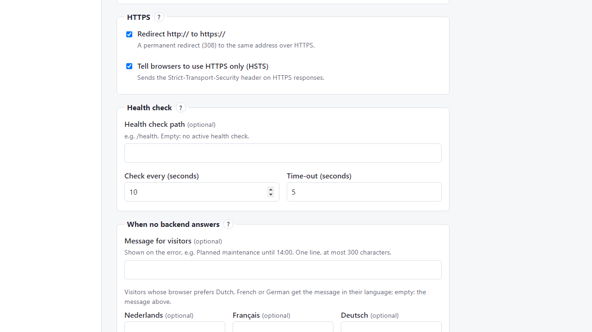

### Check it

**Test a request** describes a request (method, host, path, client address, headers) and shows what the gateway would
do with it and why: which route, which rule, allowed or blocked. Nothing is sent. Then open the site in a browser and
look at the [request log](#6-watch-the-traffic).

## 5. Protect it

The quickest start is **Templates and presets**:

| Preset | What it does |
|---|---|
| **Block common attacks** | Switches on every attack detector (SQL injection, cross-site scripting, path traversal, command injection, attack tools) and blocks probes for hidden files and unusual methods. |
| **Lock a path to your IP addresses** | Only your addresses may open a path such as `/admin`; everyone else gets `403`. |
| **Protect a login page** | Limits login attempts (POST to the login path) per client address. |
| **Limit requests per client** | A fair number of requests per minute per client address, against aggressive bots. |

A preset first shows a preview of exactly what it will change; applying it twice changes nothing. Templates open the
route, rule or rate-limit editor pre-filled for common cases.

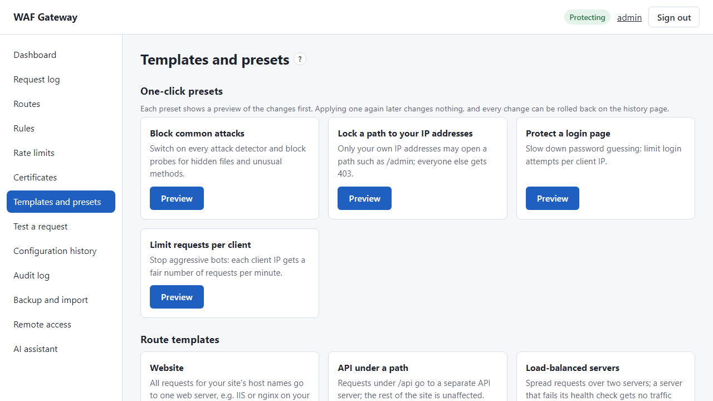

**Rules** decide per request, in order of priority (lowest number first):

- An **Allow** rule lets the request through and skips everything after it, including rate limits and attack
  detection. Use it sparingly, for trusted sources.
- A **Block** rule answers `403`.
- A **Log only** rule just records the match.

Conditions look at the client address (with ranges such as `203.0.113.0/24`), method, host, path, query string, user
agent or any header. All conditions of a rule must match. **IP block lists and allow lists** are rules too: paste
addresses and ranges, one per line.

**Rate limits** allow a number of requests per time window, counted per client address, per client and route, or for a
whole route. Clients over the limit get `429` until they slow down.

**Attack detection** (on the Rules page) can be switched off per category. **Inspect request bodies** also checks form
posts and JSON (up to 64 KB); it costs some time per request, so switch it on where the site takes input.

**Try before you enforce.** Mark a new rule or rate limit **Detection only**, or switch the whole firewall to detection
only, and watch the request log for "would be blocked" entries for a while. Then switch enforcement on.

## 6. Watch the traffic

The **Request log** shows every request, newest first. You can:

- filter by time, by what happened (blocked, would be blocked, forwarded, no route, server errors), by client, host,
  route, rule or status;
- search, and bookmark a view: the filters are in the address;
- tick **Live** to see new requests as they arrive.

Query strings, headers, cookies and bodies are not stored.

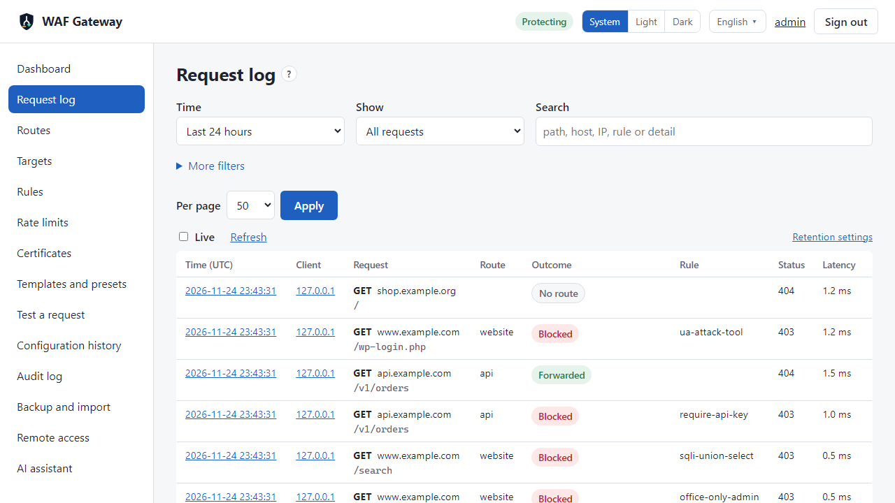

Open an entry to see the details, and turn what you see into configuration with one click. Each action opens the
normal editor, pre-filled; nothing changes until you save.

- **Block** *address*: adds the client to your IP block list, or starts one.
- **Allow this (false positive)**: a legitimate request was blocked by attack detection or a rule. Adds a narrow
  exception for that path and route.
- **Create a route for** *host*: a host with no route yet.
- **Create a rule for this path.**

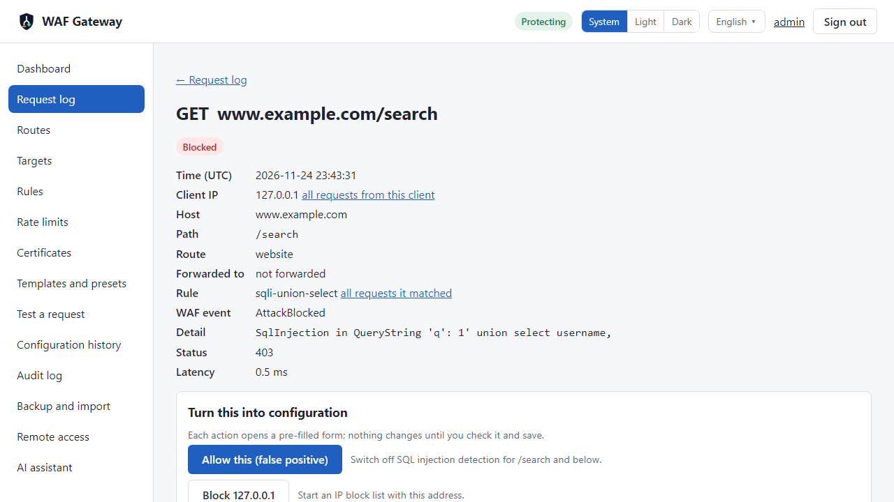

**Log retention** keeps the log bounded: by default 30 days and 1024 MB, whichever comes first. On a Raspberry Pi
with an SD card, a smaller size (for example 200 MB) is sensible.

## 7. Changes, history and backups

Every change is checked before it takes effect and is stored as a new **configuration version**. An invalid change is
refused with the reason, and the running configuration stays as it was. Changes apply immediately, without a
restart.

- **Configuration history:** every version, who made it and what it changed. Open a version to compare it with the
  running one, and **Restore** it to undo later changes. A restore is itself a new version, so nothing is lost.

  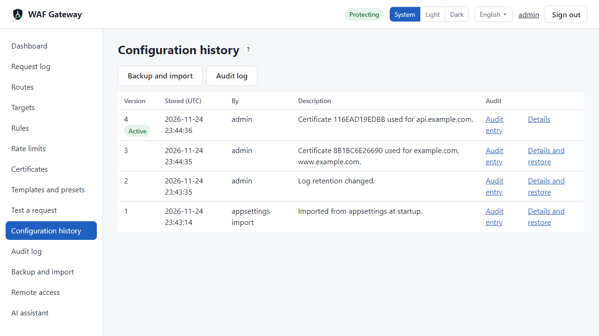

- **Audit log:** who did what and when. It covers configuration changes, sign-ins, password and two-factor changes,
  remote access, certificate uploads, downloads of configurations and backups, and restores.
- **Backup and import:**
  - **Download configuration (JSON)**: the running configuration, to keep or edit.
  - **Import**: a JSON file, with a preview of every change before it is applied.
  - **Download backup (.zip)**: every version. With **Include secrets** it also contains certificates with their
    private keys and the values of API-key conditions; keep such a file safe.
  - **Restore backup**: replaces the configuration history after checking everything. The previous database is kept
    in the data folder.

  Accounts, remote access settings and the AI key are not part of backups: they belong to the machine.

**Make a backup** before larger changes and before upgrades, and store it off the machine.

## 8. Remote access

To manage the gateway from elsewhere without an SSH tunnel, register an admin address on **Remote access**, for
example `https://admin.example.com`. Requirements:

- two-factor sign-in is on for your account;
- the host name has a working certificate (Let's Encrypt or your own);
- no route uses that host name.

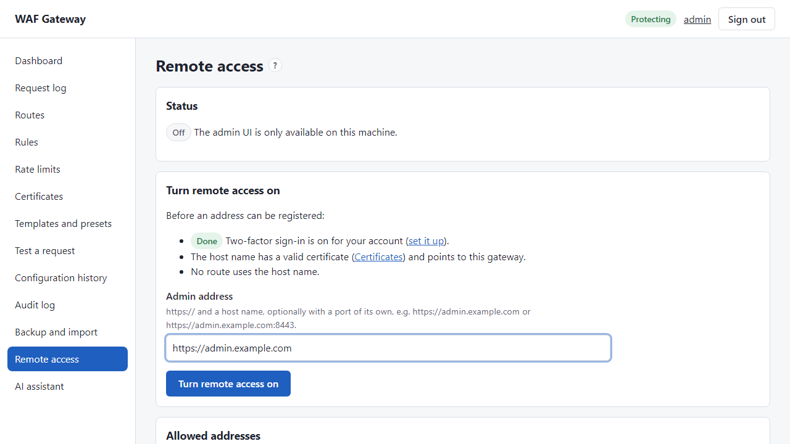

Once registered, the admin UI answers on that address over HTTPS only, and only after a sign-in with two-factor
authentication. To anyone not signed in it looks like an unknown address. Optionally restrict it to your own addresses
with the **allowlist**.

An address with a port of its own (`https://admin.example.com:8443`) takes effect at the next restart of the service.
Open that port in the firewall yourself: `.\Install.ps1 -OpenAdminPort` on Windows, `sudo ufw allow 8443/tcp` on
Linux.

To switch it off, use the page, or on the gateway's machine run `wafctl admin unregister-url`.

## 9. The AI assistant

Optional; off until you add an Anthropic API key under **AI assistant → Settings and what is sent**. The page shows
exactly what would be sent. Only your request and a summary of routes, rules and settings go to Anthropic: never
secrets, certificates, the request log or accounts. Usage is billed to your Anthropic account.

1. Describe one change in your own words, for example *"Only the office network 203.0.113.0/24 may open /admin."*
2. The answer is checked like an imported file. A proposal that fails the checks can never be applied.
3. Review the differences in plain language, then **Apply these changes**. The change becomes a normal configuration
   version, and **Undo** rolls it back.

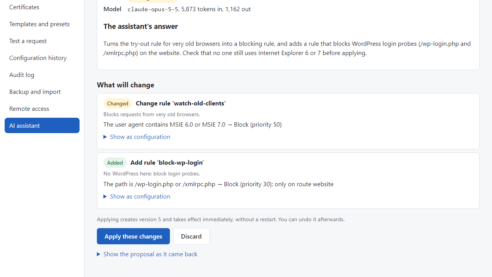

## 10. When something goes wrong

`wafctl` works on the gateway's machine even when the service is down or you are locked out. Run it as Administrator
on Windows and with `sudo` on Linux. Every change it makes is a normal configuration version, recorded in the audit
log, and a running gateway applies it within seconds.

| Problem | What to do |
|---|---|
| **A rule blocks you or your visitors** | Fix or disable the rule in the admin UI (the admin UI itself is never subject to rules). Or restore the previous version under Configuration history. From the command line: `wafctl rules disable-all`, or `wafctl mode detection-only` to stop all blocking while you investigate (`wafctl mode enforce` switches it back). |
| **A change broke the site** | Configuration history → open the last good version → **Restore**. Or `wafctl config restore-last-good`, or `wafctl config restore-last-good --version 7`. |
| **Badge "Unavailable: public traffic is refused"** | Hover over the badge for the reason. Restore a working version, as above. Public traffic stays refused (`503`) until the firewall works again. That is deliberate: nothing passes unchecked. |
| **Forgot the password, or locked out** | `wafctl admin reset-password`. It sets a new password, unlocks the account and ends all sessions. A lockout also ends by itself after 15 minutes. |
| **Lost the phone with the authenticator app** | Sign in with a recovery code: after the password, choose **Use a recovery code** instead of entering a code. Or run `wafctl admin reset-2fa` on the machine. |
| **Remote access locks you out** | `wafctl admin unregister-url` turns it off; `wafctl admin allow-ip <address>` adds your address to the allowlist. |
| **The service does not start** | Look at the service log: the Windows Event Log, or `journalctl -u wafgateway -n 50`. The most common cause is another program on port 80 or 443; the installer names it. |
| **Let's Encrypt fails** | Check that the host name points to the gateway and that port 80 is reachable from the internet. The reason is on the Certificates page. Then **Request certificates now**. |
| **Visitors see "This site is temporarily unavailable"** | No backend of the route answered. The dashboard counts these errors per route; in the request log (**Server errors (5xx)**) each request shows the reason ("No backend available", "Backend error", "Backend timeout") and the backend that was tried; search for the request ID from the error page to find one. Check that the backend machine and its service run. |
| **A route is "On failover"** | None of its primary backends is healthy, so a failover backend answers. Check the primary machine and its service; the request log shows which backend served each request. Traffic returns by itself 30 seconds after the primary is healthy again. |
| **A legitimate request is blocked** | Open it in the request log and choose **Allow this (false positive)**. |

`wafctl status` shows the data folder, the active configuration, the admin accounts and remote access. `wafctl config
history` lists the versions. The [README](../README.md#recovery-tool) has every command.

## 11. Maintenance

- **Upgrades:** download the new package and run its installer again (`Install.ps1` or `sudo bash install.sh`). The
  service stops, the program is replaced and the service starts again. Configuration, accounts, logs and your own
  settings are kept. Make a backup first.
- **Backups:** download a backup regularly and keep it somewhere else. With **Include secrets** the backup contains
  your certificates' private keys, so store it encrypted.
- **Certificates:** Let's Encrypt renews automatically. Uploaded certificates must be replaced before they expire; the
  dashboard warns 30 days ahead.
- **Disk space:** the request log stays within its retention limits.
- **Raspberry Pi:** see [Raspberry Pi tuning](../README.md#raspberry-pi-tuning) for a memory limit, fewer writes to
  the SD card, and moving the data to an SSD.
- **Security reports:** see [SECURITY.md](../SECURITY.md).
