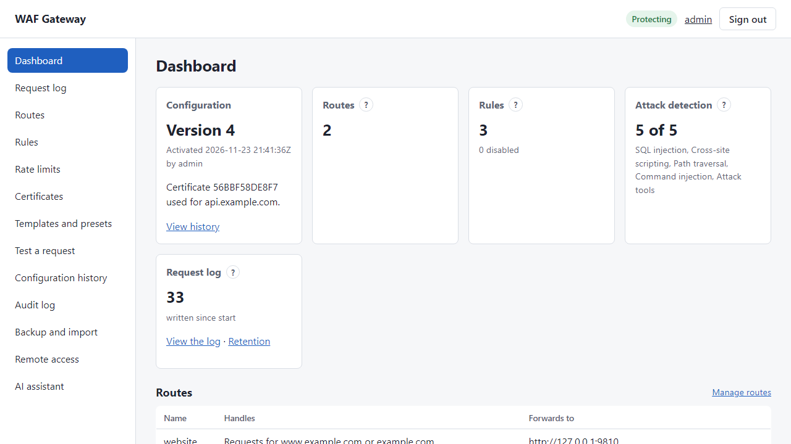
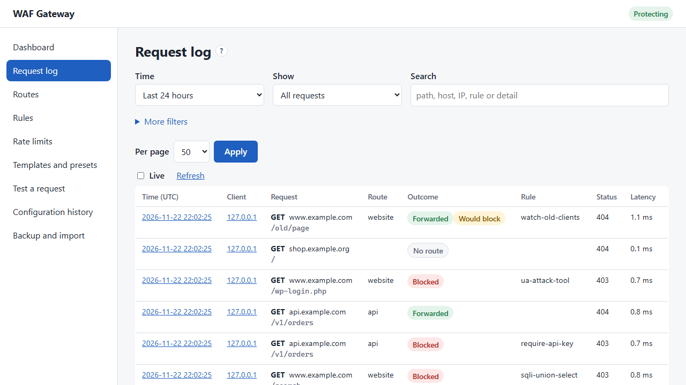
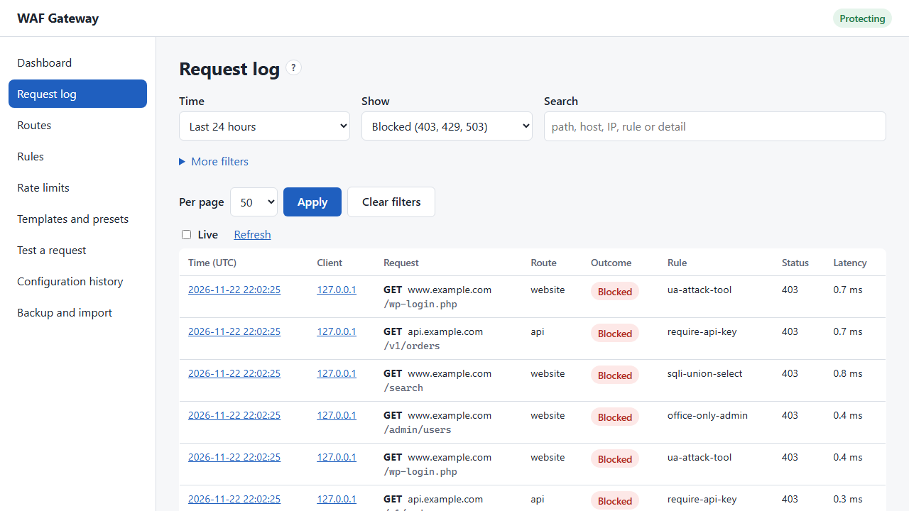
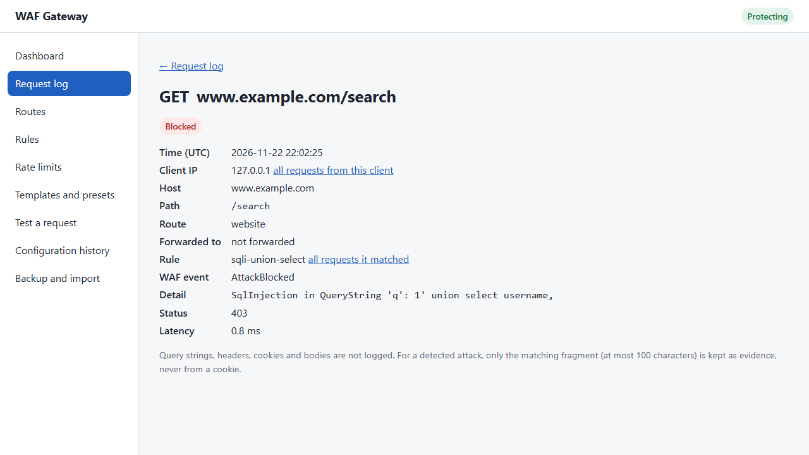
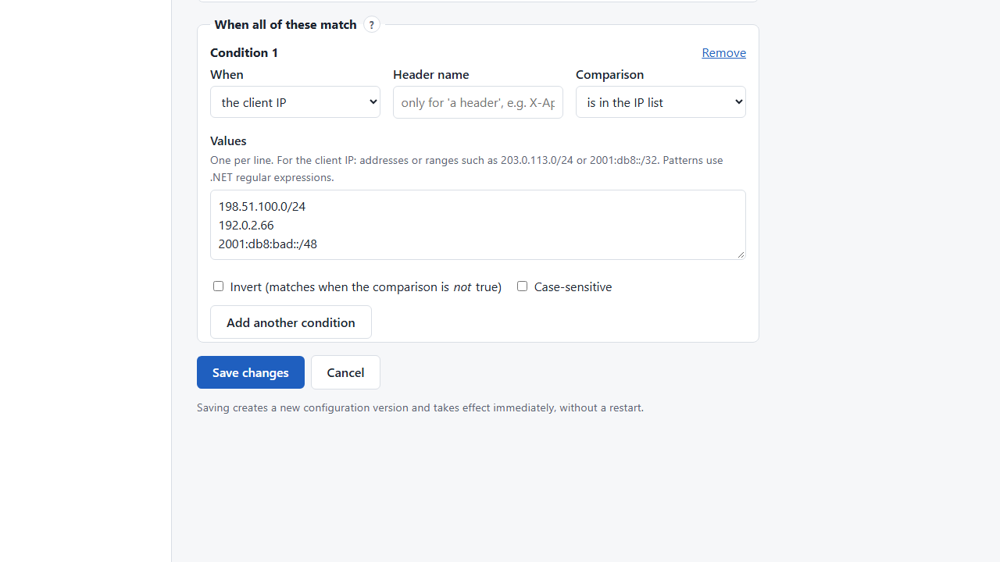
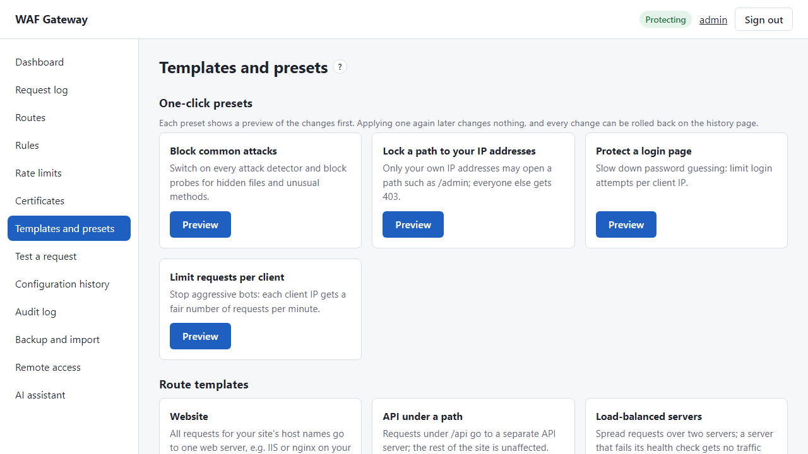
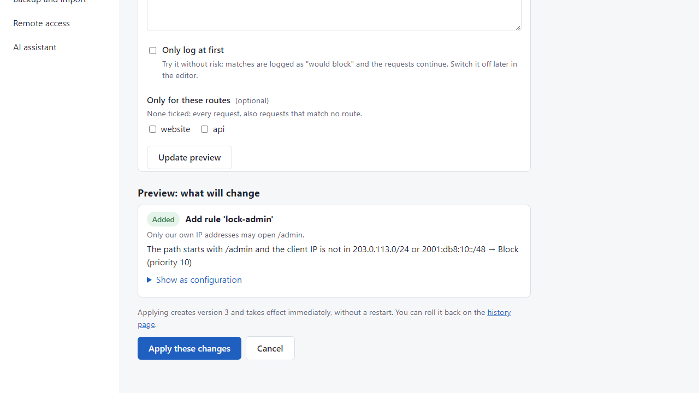
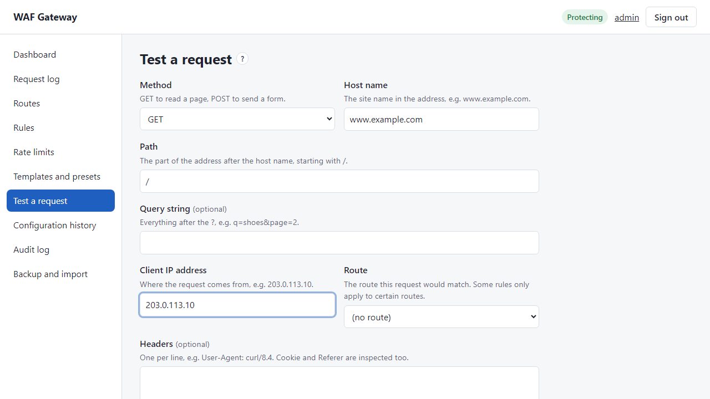
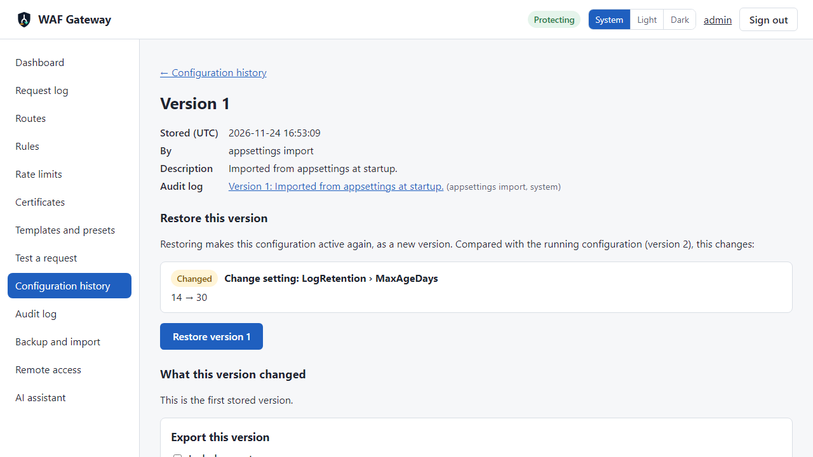

# Admin UI screenshots

Screenshots of every page of the WAF Gateway admin UI at 1280×720. They use the example configuration (`schemas/gateway-config.example.json`) plus a few changes made through the UI, so the history has several versions.

- [Dashboard](#dashboard)
- [Request log](#request-log)
- [Routes](#routes)
- [Rules](#rules)
- [Rate limits](#rate-limits)
- [Templates and presets](#templates-and-presets)
- [Test a request](#test-a-request)
- [Configuration history](#configuration-history)
- [Backup and import](#backup-and-import)

## Dashboard

The firewall state, the active configuration version, and the routes, rules, rate limits and attack detection in plain language.

## Request log

Every public request, newest first, with filters, free-text search and a live view.

Only the blocked requests, with the rule that blocked each one.

One entry in detail: an SQL injection blocked by attack detection.

## Routes

The list of routes: which requests go to which backends.

Editing a route: host names, path prefix, methods, backends and health check.

Deleting a route is refused while rules or rate limits still refer to it.

## Rules

The rules in priority order, with the global detection-only switch.

Editing a rule: action, priority, detection-only, route scope and conditions.

An IP block list: paste addresses and CIDR ranges, one per line.

## Rate limits

The rate limits and what each one counts.

Editing a rate limit: limit, window, what is counted, routes and conditions.

## Templates and presets

The library of one-click presets and templates for routes, rules and rate limits.

The preview of the "Block common attacks" preset: nothing changes until you apply it.

The "Lock a path to your IP addresses" preset, with its settings and the preview of the rule it adds.

## Test a request

Describe a request to see whether the firewall would allow or block it, without sending anything.

The result: a blocked SQL injection, with the reason.

## Configuration history

Every configuration version, with the active one marked.

A version's details: what restoring it would change compared with the running configuration.

## Backup and import

Export the configuration, import a file, download a full backup or restore one.

The preview of an import: the file was exported without secrets, so the running values are kept.

